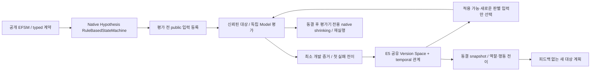
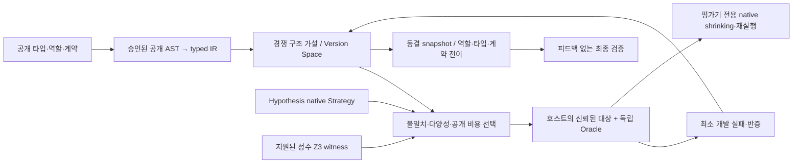
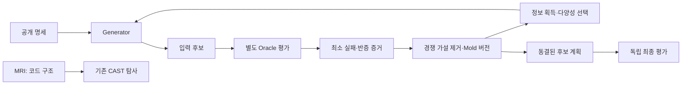

# Antemortem Structural Lab

## E8-R2 작업 후보 — 실패 구조를 보존하는 새 수치 입력 생성

**실패 입력을 그대로 저장하는 기능과, 실패가 발생한 수치 구조를 보존하면서 새로운 입력을 생성하는 기능을 구분합니다.** R2는 R1의 EXACT·SUFFICIENT·NECESSARY·EMPIRICAL 의미와 readiness를 재사용하고, 실패·정상 개발 관측으로 보정한 입력 생성 레시피를 별도 경량 가이드로 실행합니다. 레시피는 실패 분류식이나 Oracle 정답이 아닙니다.

공개 PyPI **`0.7.0a1`에는 R1·R2가 없습니다.** 아래 수치 명령은 PR #8의 **미발행 `0.8.0a1` 연구 후보**를 checkout에서 설치하거나 후보 wheel을 별도 환경에 설치한 뒤 사용합니다. 공개 패키지 설치 안내와 기존 E7 파일·태그·해시는 아래에 보존합니다. 이번 작업은 PyPI를 다시 게시하지 않습니다.

수치 프로파일은 고정 `omega-lock` revision `14ff508b2974298305d74c1c90bb43d3c0c13b82`의 검토된 `pearson_result` 계산을 사용합니다. 유한 float `[-1,1]`, 동길이 3~6개를 허용하며 정확 상수열은 포함합니다. 비상수열의 정확한 중심 제곱합이 `1e-6`보다 작으면 기존 Source domain에서 거절합니다. 거의 상수인 영역은 별도 `NEAR_CONSTANT_DIAGNOSTIC` 프로파일이며 주평가에 섞지 않습니다. 원본 생산 코드는 수정하지 않습니다.

공개 사전지식은 상수 Pearson 입력의 퇴화와 공개 산술 경로의 중심화 반올림입니다. 상수축·값·길이·표현·부호/스케일·인접 float·순열/반복·정상 대조를 Hypothesis native Strategy로 생성하고, 실제 float 입력과 기존 Oracle 비교 계약으로 다시 평가합니다. `HAND_SPECIFIED_PRIOR`, `SOURCE_CALIBRATED_GUIDANCE`, `OBSERVED_VALIDATION_RESULT`의 출처를 분리합니다. 사용자 제공 `[0.1]*3` 진단은 제공된 개발 단서이며 엔진의 독립 발견이 아닙니다.

현재 동봉 가이드는 검증된 기존 413개 Source 개발 관측(기존 371개와 R1의 정상 42개)으로 보정했습니다. 기존 실패 5개는 오른쪽 상수축의 같은 중심화 기전이며 Python 3.11·3.12에서 재현했습니다. 레시피는 해당 family에 가중치 16, 나머지 공개 family에 1을 배정합니다. B·D는 동일한 공개 수치 지식을 사용하고 D만 관측으로 배정을 보정합니다. C는 D와 같은 실패 자료를 재생·일반 변형합니다. 새 입력 수가 늘어도 결함 기전 수가 늘어난 것으로 세지 않습니다.

전체 72,801,555바이트 감사 archive는 host에 유지합니다. 원본을 기존 규칙으로 검증한 뒤 컴파일한 실행 가이드는 canonical JSON 기준 3,448바이트이며, 원시 입력·정답·전체 journal·임의 실행 코드를 포함하지 않습니다. 실행 시에는 host가 보관한 예상 digest와 원본 검증 영수증을 함께 검사합니다. 가이드 상한 1MiB와 전체 요청 8,000,000바이트 상한을 유지합니다. 전체 archive를 Docker에 보냈다는 뜻은 아닙니다.

Hypothesis 6.170.11의 native float Strategy는 import된 모듈에서 수집한 숫자 상수의 영향을 받을 수 있습니다. 실제 QA에서 공개 상수 하나의 import만으로 평가자 host와 최소 worker의 후보가 달라지는 경로를 확인했습니다. 따라서 A·B·C·D 모두 같은 최소 허용 모듈만 복사한 별도 생성 process를 사용하고 평가자·Oracle 모듈은 import하지 않습니다. A·B에는 D의 보정 레시피를 전송하지 않으며, C에만 공정한 재생·일반 변형에 필요한 기존 실패 입력을 bounded 데이터로 전달합니다. C의 입력을 포함해 Oracle 출력·라벨은 전송하지 않고 D 가이드는 원시 입력 없이 유지합니다. Hypothesis 내부 구현은 수정하지 않습니다. host 기준 경로도 별도 최소 process로 실행하며 seed뿐 아니라 Python·Hypothesis 버전·모듈 문맥·입력 계약을 함께 확인합니다.

### R2 후보 설치와 실제 명령

아래 명령은 후보 wheel을 설치한 별도 환경 또는 연구 checkout을 기준으로 합니다. `0.8.0a1`은 PyPI 설치 대상으로 안내하지 않습니다. 모든 출력은 새 경로를 사용합니다. 전체 회귀 669개가 실패·오류·skip 0으로 통과했고, 별도 새 환경에 설치한 실제 후보 wheel·README 경로 검사 20개(성공 18개·필수 차단 2개)가 통과했습니다. 로컬 QA 의존성은 바이트를 확인한 기존 승인 배포판 4개를 재사용했으며 일반 index에서 새로 설치했다고 주장하지 않습니다. Docker·일반 index의 새 의존성 설치·원격 CI 상태는 [이 head의 PR Checks](https://github.com/hibou04-ops/antemortem-structural-lab/pull/8/checks)에서 확인합니다. [R2 보고서](docs/E8_R2_REPORT.md)는 Source 검증과 설치 검증의 범위를 구분합니다.

```powershell
python -m pip install ".[qa,solver]"
python -m tomolab numerical-demo --workspace results/r2-functional --budget 16 --size 4 --max-examples 128 --output results/r2-demo.json
python -m tomolab numerical-inspect --guide results/r2-functional/guide.json --approval results/r2-functional/approval.json --expected-digest-file results/r2-functional/guide.sha256 --output results/r2-inspect.json
python -m tomolab numerical-run --guide results/r2-functional/guide.json --approval results/r2-functional/approval.json --expected-digest-file results/r2-functional/guide.sha256 --method D --allow-local-execution --budget 16 --size 4 --max-examples 128 --output results/r2-run.json
```

`numerical-demo --workspace`는 공개 제공 진단의 작은 기능 archive와 recipe·guide·approval·별도 digest 파일을 새 폴더에 만듭니다. 이 기능 예제를 실제 413개 관측의 비교 결과로 계산하지 않습니다. `numerical-demo`에서 `--workspace`를 생략하면 사전 승인된 실제 Source 경량 가이드를 사용하되 전체 비공개 archive는 읽지 않습니다. `numerical-run/compare`의 `--allow-local-execution`은 고정된 검토 Source와 Oracle의 host 실행 승인이며 OS 격리를 의미하지 않습니다. Docker backend는 후보 생성 worker에 적용됩니다.

별도 단계인 `numerical-prepare → numerical-compile → numerical-inspect/run/compare`와 후보 wheel 설치·검증 방법은 [전체 사용 흐름](docs/E8_R2_REPORT.md#실행-경로)에 있습니다. 알려진 입력 재생, 첫 평가 유효 입력, 새 실패 입력, 기전 수, domain 거절, Oracle 오류와 생성·직렬화·worker·Oracle·축소·재현 시간을 구분합니다. 최초 수집비용은 `UNKNOWN`으로 남기며, archive 재사용 추가 비용도 별도 기록합니다.

### R2 검증과 공개 상태

새 Source 개발 비교는 길이 4·5·6, seed 13·47·89, 방법별 후보 32개·draw 상한 512개·실제 Source/Oracle 쌍 상한 96개·축소 상한 16회를 동결한 뒤 한 번 실행했습니다. A/B/C/D의 고유 새 유효 입력은 94/92/77/93개, 고유 새 실패 입력은 **0/15/24/44개**였습니다. C의 seed별 실패 합계 26개를 고유 입력 24개와 구분합니다. B·C·D가 재현한 것은 모두 같은 기존 기전 1개이며 새 기전은 0개입니다.

측정한 준비 1회 포함 전체 비용은 A/B/C/D가 2.83759/2.95153/3.37563/23.54118초입니다. D의 23.54118초는 준비 16.90675초와 현재 실행 6.63443초를 포함합니다. D가 같은 결함의 새 입력을 더 많이 만들었지만 B·C보다 비용이 커 사전 기준의 종합 추가 가치를 충족하지 못했습니다. 판정은 **`NO_ADDITIONAL_VALUE_OVER_DOMAIN_PRIOR`**입니다. 최초 역사적 수집비용은 `UNKNOWN`이며 전체 역사 비용을 측정한 값이 아닙니다. [사전 고정 계약](docs/E8_R2_CONTRACT.json)의 `NOT_EXECUTED`는 당시 선언 상태로 보존하고, [현재 실행 결과 JSON](docs/E8_R2_RESULTS.json)과 [보고서](docs/E8_R2_REPORT.md)에 완료 결과를 기록합니다. 결과를 보고 같은 배치를 재실행하거나 recipe를 다시 보정하지 않았습니다.

독립 C와 적격 미소비 Target이 없어 외적 일반화는 검증되지 않았습니다. PR #8은 draft, `allow_release=false`를 유지하며 main 병합·새 tag·GitHub Release·PyPI upload는 실행하지 않습니다. 아래 R1·E8 결과와 소비 이력은 보존 기록입니다. 과거 특징 라벨 충돌 0개는 해당 표본의 완전 충돌 부재만 뜻하며 새 입력 생성 능력의 증거가 아닙니다.

## E8-R1 작업 후보 — 정확 분류와 부분 규칙을 구별하기

같은 조건이라도 **완전한 실패 분류식·일부 실패의 충분조건·실패의 필요조건·경험적 탐색 규칙**은 다른 주장입니다. 기존 정확 분류의 반증을 지우지 않고 새 의미 버전과 ID로 검토합니다. Oracle는 계속 실제 결과를 판정하고, 규칙은 후보 순서와 제한된 탐색 예산에만 사용합니다.

| 종류 | 관측 범위에서 주장하는 관계 | 반증 | 보장하지 않는 것 |
|---|---|---|---|
| EXACT | R ↔ F | FP 또는 FN | domain 밖의 완전 분류 |
| SUFFICIENT | R → F | FP | 다른 영역의 모든 실패 설명 |
| NECESSARY | F → R | FN | R을 만족하면 실패한다는 주장 |
| EMPIRICAL | 순서·예산의 제한적 유용성 | 별도 개발 검증의 비용·효용 | 충분조건·정답·인과 법칙 |

기존 Source371개에 대한288표현은 FP만 있는54개와 FP·FN을 모두 가진234개였습니다. **기존288개 모두 FP가 있으므로 충분조건으로 이름만 바꿔도 모두 반증됩니다.** 필요조건으로 남는54개 중 좌표 전용을 제외한19개는 추가 검증 전 Source 탐색 후보입니다. 전체 특징의 라벨 충돌은0개였고, 추가 입력 특징은0개로 고정했습니다.

기존288원자와 사전에 제한한 AND/OR/NOT128개를 합친416고유 표현을 네 의미로 검토했습니다.1,664개 ID를 네 배의 독립 지식으로 계산하지 않습니다. EXACT416개 전부 반증, SUFFICIENT415개 반증·나머지1개는 TP0, NECESSARY86개는 관측 범위에서 무반증, EMPIRICAL245개는 학습 단계의 후보였습니다. 이후 새 Source 비교에서 경험적14개는 효용을 입증하지 못했고402개는 미검증이며 채택은0개입니다. 후보 수는 성능이나 qualified 지식 수가 아닙니다. [실제 방향·종류별 셀·한계](docs/E8_R1_REPORT.md) · [기계 판독 결과](docs/E8_R1_RESULTS.json).

### 실제 사용자 흐름

`개발 증거 → 의미별 학습 → TP/FP/FN/TN/UNKNOWN·증거 ID 확인 → 동결 → 새 Source 배치 검증 → 제한된 guidance와 Oracle 실행 → Source 결과와 독립 전이 적격성 분리`

아래 명령은 동봉된 직접 작성 정수 예제를 사용하는 기능 검사입니다. 실제 프로젝트의 발견이나 외적 전이 결과가 아닙니다. 소스 checkout 또는 설치 wheel의 동봉 예제 폴더에서 실행하고, 기존 산출물이 있으면 새 output 경로를 사용합니다. `semantic-demo`는 이 작성 예제의 실행에 한정된 명령입니다. `semantic-run`에서 직접 코드를 실행할 때는 `--allow-local-execution`이 필요하며 OS 격리를 뜻하지 않습니다.

```powershell
python -m tomolab semantic-demo --budget 12 --output results/e8-r1-demo.json
python -m tomolab semantic-inspect --archive results/e8-r1-demo.json --output results/e8-r1-inspect.json
python -m tomolab semantic-plan --archive results/e8-r1-demo.json --spec examples/partial/spec.json --provenance examples/partial/provenance.json --purpose SOURCE_DEVELOPMENT --budget 12 --guidance-budget 4 --pool-size 32 --seed 313 --output results/e8-r1-plan.json
python -m tomolab semantic-run examples/partial/target.py --oracle-file examples/partial/oracle.py --spec examples/partial/spec.json --provenance examples/partial/provenance.json --oracle-validation examples/partial/oracle-validation.json --archive results/e8-r1-demo.json --method C --allow-local-execution --budget 12 --guidance-budget 4 --pool-size 32 --seed 313 --output results/e8-r1-run.json
```

검토한 공통 개발 로그는 `semantic-learn --bundle ... --implementation-hash ... --spec-hash ... --parent-snapshot ... --semantic-policy ...`로 가져옵니다. `--claim-kind`를 반복 지정할 수 있으며 종류를 생략하면 네 의미를 명시적 R1 스키마로 검토합니다. 기존 archive를 기본 API로 읽으면 기존 정확 의미를 유지합니다. `semantic-inspect`는 counterevidence·UNKNOWN의 증거 ID와 각 상태를 보여 줍니다. 실제 비공개 자료의 결과는 host에 보관하고 공개하지 않습니다.

별도의 새 Source 배치를 준비했다면 `semantic-validate --archive ... --bundle ... --implementation-hash ... --spec-hash ... --generation-id ... --approve-development-evidence`로 연결합니다. 이 배치는 같은 Source의 입력 검증이며 C가 아닙니다. 부모 동결 해시를 연결한 새 세대에 추가하고 전체 관측을 보존합니다. 경험적 규칙은 `--allow-unvalidated-empirical`을 명시한 Source 개발 시험에서만 미채택 후보로 사용할 수 있습니다. 별도 배치의 실제 후보 변화·새 guided 입력의 첫 확인 발견·호출·비용과 사전 기준을 갖춘 효용 영수증 없이는 채택하지 않습니다. Native나 알려진 입력 재생의 발견은 규칙 효용으로 승격하지 않으며, 비교 배치의 연관 효과를 개별 규칙의 인과 효과로 표현하지 않습니다.

Guidance는 계획의 최대 절반이며 native 난수 흐름과 별도로 생성합니다. 필요조건을 모든 실패의 강제 필터로 쓰지 않고 유효 후보를 못 만들면 native로 복귀합니다. UNKNOWN은 false가 아니고 NOT UNKNOWN도 UNKNOWN입니다. 수치 실행은 기존에 검토한 tolerance·정확한0·epsilon·domain·예외 계약을 보존해야 하며 기존 `EXACT_CANONICAL_JSON` 수집기에 맞춰 기준을 바꾸지 않습니다.

### 현재 검증 범위

학습·새 Source 검증은 Gate A, 독립 C·미소비 T·Oracle·실효 guidance를 요구하는 외적 전이는 Gate B입니다. 현재 C·T가 없어 외적 전이는 `NOT_EXECUTED_READINESS_BLOCKED`입니다. 새 Source 입력42개를 각3회 실행한126쌍은 모두 정상이며 새 실패는0개였습니다. A/B/C는 각각40/40/41쌍에서 미검출, D는 알려진 Source 반례를3쌍으로 확인했습니다. C는 새 guided 입력8개로 선택을 바꿨지만 비용9.279995초와 중복1회가 추가됐고 효용은 입증하지 못했습니다. 경험적14개는 NO_UTILITY,402개는 미검증, 채택0개입니다. 전체573개 회귀는 실패·오류·skip0으로 통과했고 wheel·sdist·공개 범위 검사, 설치 검사48개와 README 명령64개가 통과했습니다. 최신 원격 CI는 [PR #8 검사](https://github.com/hibou04-ops/antemortem-structural-lab/pull/8/checks)를 참조합니다. 고정 A→B→C→D 실행 순서와 초기화·warmup 효과 때문에 시간 차이를 인과적 우위로 해석하지 않습니다. 기존 배치를 무작위 분할해 새 블라인드 검증이라고 부르지 않습니다.

R1 부분 의미는 현재 stateless 계약만 지원합니다. 기존 stateful 경로와 E8 결과는 보존합니다. 학습 archive는63,604,940바이트, 새 배치 반영 후는72,789,151바이트로 기존8,000,000바이트 worker 전송 한도를 넘기므로 현재 대형 archive의 계획 경로는 신뢰한 host의 논리적 경계입니다. 이 자료의 Docker 실행을 검증했다고 주장하지 않습니다. R1 snapshot만128MiB로 제한하며 legacy8MiB 한도는 유지합니다. 새 공개 Release는 만들지 않았습니다.

이하 E8 원래 안내와 결과는 보존 기록입니다.

## E8 작업 후보: 개발 증거 연결과 최종 평가 차단

현재 작업 버전은 `0.8.0a1`이며 공개 릴리스는 만들지 않았습니다. **실제 개발 실패를 기존 지식 엔진에 연결했지만, 살아 있는 구조적 가설과 독립 검증 근거가 없어 최종 비교는 실행하지 않았습니다.** 도구 중립적인 수용과 기본 Native Hypothesis 수집기를 추가한 제품 변경입니다. 전이 성능 향상을 입증한 결과는 없습니다.

| 실제 개발 자료에서 확인한 항목 | 결과 |
|---|---:|
| 기존 E7 v2에서 수용한 해당 Source 관측 | 371개, 누락 0개 |
| 재현 근거가 연결된 실패 입력 / 이미 알려진 결함 기전 | 5개 / 1개 |
| 기존 문법이 생성한 후보 / 반증된 후보 | 288개 / 288개 |
| 좌표만 저장한 후보 | 210개, 위 288개의 부분집합 |
| 살아 있는 구조적 가설 / 독립 C / 적격 T / qualified guidance | 모두 0개 |
| 새 생산 코드·Oracle 호출 / 최종 A~D 비교 | 0회 / 미실행 |

[개발 보고서](docs/E8_DEVELOPMENT_REPORT.md) · [공개 결과](docs/E8_RESULTS.json) · [평가 계약](docs/E8_EVALUATION_CONTRACT.json)

### 실제 사용 흐름

`개발 실패 로그 가져오기 → Oracle·출처 확인 → 구조적 후보 생성 → 독립 개발 근거 연결 → Target 적용 검사 → readiness 확인 → 적격할 때만 동결 비교`

- 기본 새 수집기는 Native Hypothesis의 기존 생성·축소를 사용합니다. 검토한 대상·Oracle에만 명시적으로 실행을 승인해야 합니다. `max-calls`는 모든 재현을 포함한 **Target 호출과 Oracle 호출의 합**입니다.
- 다른 도구의 기록도 같은 `DEVELOPMENT` 계약으로 가져올 수 있습니다. 도구 이름으로 수용 여부나 구현 독립성을 판정하지 않습니다. 실제 결과·출처·Oracle 검토·입력 domain·재현 영수증이 필요하며, 오류와 재현 미확인은 격리합니다.
- Source 학습에는 기존 `KnowledgeArchive.from_failure_log()`를 사용합니다. 같은 Source의 추가 관측은 기존 개발 관측 경로로 연결합니다. Source와 관측 각각의 256개 상한을 보존하며, 전체 512개를 넘기거나 초기 256개에 실패가 없으면 기록을 골라 바꾸지 않고 중단합니다.
- 승격에는 **동일한 별도 검토 구현·Oracle에서 얻은 양성·음성 예측 검증**이 필요합니다. 도구 변경, 이름 변경, 복제본, 수정 전후 한 계보만으로 독립 C를 충족하지 않습니다. 기존 반증과 부모 세대는 보존합니다.
- 적격 지식이 있어도 새 Target의 공개 계약에 적용되고, empty archive와 다른 유효 후보·순서를 실제로 만들어야 합니다. 최종 답·실패 입력·패치는 Generator에 제공하지 않습니다.

소스 checkout에서 로컬 후보를 설치하고 공개 기능 예제를 실행하는 명령입니다. 설치 wheel에서는 동봉된 예제 폴더를 기준으로 같은 상대 경로를 사용합니다. 아래 예제는 직접 작성한 기능 검사이며 연구 성과에 포함하지 않습니다.

```powershell
python -m pip install ".[qa,solver]"
$EvidenceRoot = Join-Path $env:TEMP 'tomolab-e8-authored-example'
New-Item -ItemType Directory -Force $EvidenceRoot | Out-Null
python -m tomolab evidence-collect examples/evidence/target.py --oracle-file examples/evidence/oracle.py --spec examples/evidence/spec.json --provenance examples/evidence/provenance.json --oracle-validation examples/evidence/oracle-validation.json --function-identity authored-identity --generation-id E8-AUTHORED-DEMO --allow-local-execution --budget 8 --max-calls 16 --output "$EvidenceRoot/collection.json"
python -m tomolab evidence-inspect --bundle "$EvidenceRoot/collection.json"
$Origin = Get-Content examples/evidence/provenance.json | ConvertFrom-Json
$Review = Get-Content examples/evidence/oracle-validation.json | ConvertFrom-Json
python -m tomolab evidence-learn --bundle "$EvidenceRoot/collection.json" --implementation-hash $Origin.implementation_sha256 --spec-hash $Review.public_spec_hash --output "$EvidenceRoot/source.json"
python -m tomolab readiness-demo
```

`evidence-inspect`에서 격리 이유, 새 실행 비용과 캐시 재사용을 확인합니다. 별도 검토한 C가 있다면 `evidence-corroborate`로 연결합니다. [동봉된 안내](examples/evidence/README.ko.md)에 가져오기·보강 명령과 파일 계약을 설명합니다. `--allow-local-execution`은 현재 host에서 검토한 코드를 실행하는 동의이며 OS 격리가 아닙니다. 기본 새 수집기는 사전 승인한 `EXACT_CANONICAL_JSON` 비교만 지원합니다. 수치 허용오차나 명세상 정상 예외 비교를 요구하는 계약에는 사용할 수 없습니다.

### qualified가 0일 때와 최종 평가

현재 실제 E8 자료는 모든 후보가 `CONTRADICTED`이고 독립 C·적격 T·실효 guidance가 없습니다. 최종 상태는 **`NOT_EXECUTED_READINESS_BLOCKED`**입니다. `readiness-demo`는 빈 자료에서 차단되는 기능 예제이며 실제 E8 연구 자료를 공개한 실행이 아닙니다.

검토한 비공개 host 자료를 준비했다면 다음처럼 검사합니다. `HOST/...`는 사용자가 근거와 사용 이력을 갖춰 준비하는 파일 경로입니다.

```powershell
$AuthorityId = python -c "from tomolab.discovery.evaluation_usage import UsageLedger; import sys; print(UsageLedger(sys.argv[1]).authority_id)" HOST/e8-usage.jsonl
python -m tomolab readiness-check --bundle HOST/e8-readiness-bundle.json --usage-ledger HOST/e8-usage.jsonl --authority-id $AuthorityId --output results/e8-readiness.json
```

`$AuthorityId`는 고정 장부 경로에서 계산한 64자리 SHA-256이며, 평가 계약에 등록한 값과 같아야 합니다. 이 검사는 최종 실행 승인이 아닙니다. 아래 최종 host 실행기는 환경에 고정된 정본을 사용하고 기존 소비 기록을 추가 검사합니다.

필수 근거가 부족하면 종료 코드 `3`과 차단 이유를 반환하며 최종 Target 측정을 시작하지 않습니다. 현재 차단 이유는 `NO_SURVIVING_HYPOTHESIS`, `NO_INDEPENDENT_CORROBORATION`, `NO_APPLICABLE_TARGET`, `NO_EFFECTIVE_GUIDANCE`입니다. 새 C/T의 검토된 Oracle와 평가자 전용 양성·정상 대조 영수증도 확보하지 못했습니다. 최종 평가를 실행하지 않은 상태를 `INCONCLUSIVE`로 기록하지 않습니다.

소스 checkout의 최종 host 실행기도 같은 부족 조건을 실제 대상 import 전에 차단합니다. 현재 자료의 차단 확인 경로는 다음과 같습니다.

```powershell
python scripts/evaluate-e8.py --bundle HOST/e8-readiness-bundle.json --output results/e8-blocked-comparison.json
```

실제 최종 실행에는 고정 host 권한 정본·등록된 평가자 매핑·제품 해시·공유 사용 이력이 추가로 필요합니다. 출력 폴더를 바꾸어 사용 이력을 초기화할 수 없습니다. 이 host 계약은 Oracle의 진실성이나 전 세계 실행 이력·OS 격리를 보장하지 않습니다.

기존 개발 기록의 재사용은 `CACHED_OBSERVATION_REPLAY`입니다. 과거 실제 관측들의 결과 일치를 확인한 것이며 E8에서 새로 두 번 재실행한 기록은 아닙니다. Source 371개는 기존 초기 학습 256개와 동일 Source 개발 관측 115개로 모두 연결했습니다. 기존 snapshot의 `independent_observations=115`는 관측 행수라는 명칭이며 실제 독립 C는 0개입니다.

캐시 기록 전체 재구성은 262.921447초, 승인 없는 음성 메타데이터 readiness 진단은 약 2.544초였습니다. 두 값은 개발·진단 비용이며 A~D의 성능 비교가 아닙니다. 최초 자료 수집 비용을 무료로 간주하거나 경제적 ROI를 자동 판정하지 않습니다. A~D 비교와 추가 가치·손실 분석은 실행되지 않았습니다. 과거 결함을 향후 재현하면 `HISTORICAL_DEFECT_REDISCOVERY`로 구분하며 새 생산 결함 발견이나 일반화 우위로 표현하지 않습니다.

전체 회귀 506개(기존409＋신규97)가 82.569초에 통과했고 실패·skip은 0개입니다. 기존 28개 검사 파일의 SHA가 유지됐으며 이후 비용 계측 보완 관련 29개 검사도 통과했습니다. 빌드·메타데이터·공개 범위와 설치 wheel 검사37개, README 명령60개가 통과했습니다. 기본 설치는 새 venv, QA는 승인된 기존 의존성으로 확인했습니다. Docker 격리와 CI는 draft PR의 현재 head 검사를 참조합니다. 변경은 작업 브랜치와 draft PR로 보존하며 병합·태그·릴리스를 진행하지 않습니다. 비공개 원본·입력·답·실행 로그는 공개 패키지에 포함하지 않습니다.

## 이전 공개 버전 안내 — 보존

신뢰할 수 있는 Python 함수를 검사하고, 실패한 입력을 저장하며, 그 실패를 설명하는 경쟁 가설로 다음 테스트를 선택하는 실험 도구입니다. 코드 구조를 읽는 **MRI**, 실행 결과를 관측하는 **CAST**, 반례를 찾는 **Claim-to-Witness**, 실패 조건을 학습하는 **Mold**를 제공합니다.

**한국어 사용자 안내** · [English](README.md) · [변경 이력](CHANGELOG.md) · [검증 기록](docs/RELEASE_VALIDATION.md)

`0.7.0a1`은 **Evidence-Gated Structural Knowledge**를 추가한 실험적 사전 릴리스입니다. 과거 실패에서 만든 가설을 반증·적용 계약과 함께 보존하고, 검토된 별도 구현의 대조 증거가 있는 관계만 새 탐색에 사용합니다. 범용 생성·축소는 Hypothesis에 맡깁니다. [실제 구조와 신뢰 계약](docs/E7_KNOWLEDGE.md) · [E7 독립 평가](docs/E7_EVALUATION_REPORT.md).

## PyPI 배포 채널 — 기존 E7 공개 파일

배포 이름은 `antemortem-structural-lab`, Python import와 CLI는 `tomolab`입니다. [PyPI 수동 발행 workflow](.github/workflows/publish-pypi.yml)가 성공한 뒤 [공개 버전](https://pypi.org/project/antemortem-structural-lab/0.7.0a1/)에서 파일을 확인하고 설치합니다. 아래는 그 공개 설치 검증에 사용하는 명령이며, workflow 추가만으로 게시 완료를 뜻하지 않습니다.

```bash
python -m pip install "antemortem-structural-lab==0.7.0a1"
python -m pip check
python -c "import tomolab; from importlib.metadata import version; print(version('antemortem-structural-lab'))"
tomolab --help
python -m tomolab --help
python -m tomolab demo --mode cross --budget 12
```

기본 설치는 MRI·CAST·Claim·E4 기능을 제공합니다. 아래 E7 탐색 예제에는 `qa`와 `solver` 선택 의존성을 설치합니다. 데모는 동봉된 공개 기능 fixture이며 연구 성능이나 새 결함 발견의 증거가 아닙니다.

이번 채널 추가의 업로드 대상은 [기존 `v0.7.0a1` GitHub Release](https://github.com/hibou04-ops/antemortem-structural-lab/releases/tag/v0.7.0a1)의 **동일 wheel·sdist**입니다. 현재 README의 채널 안내를 넣어 재빌드한 파일을 원본 대신 게시하지 않습니다. 원본 파일은 당시 README를 그대로 포함하고, 현재 저장소의 안내와 구분합니다. E7의 `INCONCLUSIVE` 판정과 연구 PR #1·#8의 조건은 유지합니다. [태그·파일 해시·발행 및 공개 재설치 절차](docs/PYPI_PUBLISHING.md)를 참조하세요.

## E7: 증거가 있는 구조적 지식 사용하기

지식은 `HYPOTHESIS → SUPPORTED_WITHIN_SCOPE → QUALIFIED_FOR_PROBING`으로 구분하고, 반증은 `CONTRADICTED`, 적용 근거 부족은 `APPLICABILITY_UNKNOWN`으로 남깁니다. 승격에는 동일한 별도 검토 구현에서 얻은 실패·정상 대조 관측과 호환되는 역할·타입·연산·상태/IR 계약이 필요합니다. 출처 해시는 신원을 결속하며 의미적 독립성·원인을 증명하지 않습니다.

자격 있는 지식이 없으면 worker·후보 풀·solver를 시작하지 않고 native Hypothesis를 실행합니다. 자격 있는 경우 guidance를 전체 계획 예산의 최대 절반으로 제한하고 native 탐색 경로를 유지합니다. 유한 도메인이 소진되면 실제 후보 비율은 달라질 수 있습니다. bounded prefix 뒤 동결하고 native search/shrinking과 독립 replay를 수행합니다. 새 시간 가설·상태 API는 기존 E6와 함께 사용할 수 있습니다.

이번 CI 검증 범위는 Python 3.11~3.13입니다. 패키지 메타데이터는 3.11 이상을 허용하며 더 최신 Python은 이번 검증 범위에 포함하지 않습니다. 로컬 QA는 Hypothesis6.170.11·Z35.3.2.0으로 실행했습니다.

```bash
python -m pip install "antemortem-structural-lab[qa,solver]==0.7.0a1"
python -m tomolab knowledge-demo --budget 16 --guidance-budget 4 --pool-size 16 --shrink-budget 16 --output results/e7.json
python -m tomolab knowledge-demo --case clean --budget 12 --guidance-budget 4 --pool-size 8 --shrink-budget 0 --output results/e7-clean.json
```

동봉된 directed-width 예제는 직접 작성한 기능 검사입니다. 공개 참조 모델의 `lower > upper` 관계가 실제 후보 순서를 바꾸는지 확인합니다. 이 IR은 **공개 참조 모델**의 구조이며 비공개 대상 구현을 분석한 결과가 아닙니다. 예제의 같은 실패 형태를 다른 코드로 표현한 결과를 실제 프로젝트 일반화로 계산하지 않습니다.

소스 checkout 또는 wheel에 동봉된 예제 폴더에서 최소 개발 로그를 학습하고 동결 계획을 생성하려면:

```bash
python -m tomolab knowledge-inspect --spec examples/knowledge/target-spec.json
python -m tomolab knowledge-learn --spec examples/knowledge/source-spec.json --failure-log examples/knowledge/source-failures.json --provenance examples/knowledge/source-provenance.json --public-ir examples/knowledge/source-ir.json --observations examples/knowledge/observations.json --approve-development-evidence --store results/e7-journal.jsonl --record-id development-1 --output results/e7-mold.json
python -m tomolab knowledge-plan --archive results/e7-mold.json --spec examples/knowledge/target-spec.json --target-provenance examples/knowledge/target-provenance.json --public-ir examples/knowledge/target-ir.json --budget 8 --guidance-budget 4 --pool-size 16 --output results/e7-plan.json
python -m tomolab knowledge-run examples/knowledge/target.py --oracle-file examples/knowledge/target_oracle.py --archive results/e7-mold.json --spec examples/knowledge/target-spec.json --target-provenance examples/knowledge/target-provenance.json --public-ir examples/knowledge/target-ir.json --failure-signature directed-width --allow-local-execution --budget 16 --guidance-budget 4 --pool-size 16 --shrink-budget 16 --output results/e7-run.json
```

`knowledge-learn`은 JSON 증거를 해석하고 대상 코드를 실행하지 않습니다. `--approve-development-evidence`는 출처와 독립 Oracle를 검토한 호스트의 명시적 확인이며, 임의 로그를 사실로 인증하는 장치가 아닙니다. `knowledge-run`은 별도 파일의 신뢰된 `implementation(**inputs)`·`reference(**inputs)`만 실행합니다. 실행 동의는 대상 코드의 보안 격리가 아닙니다.

새 반증을 축적할 때는 동결 부모를 보존한 새 개발 세대를 만듭니다:

```bash
python -m tomolab knowledge-update --archive results/e7-mold.json --observations examples/knowledge/counterevidence.json --generation-id development-2 --approve-development-evidence --store results/e7-journal.jsonl --record-id development-2 --output results/e7-updated.json
python -m tomolab knowledge-inspect --archive results/e7-updated.json --spec examples/knowledge/target-spec.json --target-provenance examples/knowledge/target-provenance.json --public-ir examples/knowledge/target-ir.json --output results/e7-updated-gate.json
```

append-only 저장소는 같은 record ID의 동일 입력을 중복 추가하지 않으며, 기존 반증을 버리는 과거 snapshot 복귀를 거부합니다. 세대는 최대32번, source/개발 관측은 각각 총256개로 제한합니다. 중단된 append·충돌 lock은 자동 삭제하거나 덮어쓰지 않습니다. 최종 평가 자료를 개발 관측으로 재사용하지 않습니다.

기본 subprocess는 `LOGICAL_ISOLATION_ONLY`. 선택적 Docker는 Generator만 제한하고, 대상·Oracle는 신뢰된 호스트 코드입니다:

```bash
docker build -f containers/e7-generator.Dockerfile -t tomolab-e7-generator:local containers
python -m tomolab knowledge-demo --backend docker --budget 16 --guidance-budget 4 --pool-size 16 --shrink-budget 16 --output results/e7-container.json
```

기존 E1~E6 동결 결과는 보존합니다. E6의 `NO_IMPROVEMENT`·대표 후보12/13 반증을 전체 가설 정확도로 확대하지 않습니다. E7의 개발 v1은 Oracle 정밀도 오류로 `INVALID_ORACLE / INCONCLUSIVE` 처리했습니다. 정확 산술로 수정한 Oracle의 독립 검토와 v2 계약 등록을 마쳤으며, 실제 검증 결과는 [별도 기록](docs/E7_EVALUATION_REPORT.md)에 구분해 공개합니다. 이미 관측한 개발 문제의 재검증은 새 블라인드 평가가 아닙니다. 가설을 모두 보류하고 baseline과 같아진 결과는 추가 발견 성과가 아닙니다. 계획 snapshot의 재생은 같은 Hypothesis/Z3 환경에서 검증하며 버전 간 동일 재생을 보장하지 않습니다.

새 최종 비교72건은 54 COMPLETE·18 Stateful NOT_COMPARABLE이며 필수 방법의 오류·시간 초과·대조군 오탐·Generator feedback은0입니다. Native Hypothesis·E6·E7 모두 발견0이었고, 주평가 archive의 qualified/guided도0이었습니다. 발견 우위·지식 전이 효용·외적 일반화 판정은 **INCONCLUSIVE**입니다. 최종 비교는 피드백 없는 최대64개 동결 계획에 한정하며 Hypothesis 전체 적응형 PBT 능력을 평가한 것이 아닙니다. 임의 Python 프로그램의 의미 대응을 자동 학습하는 기능은 아직 없고, 검토된 역할·의미 계약에 의존합니다.

## 보존된 E6 기능과 결과

`0.6.0a1`의 Stateful Structural Mold와 typed 입력·EFSM 지원은 유지합니다. [E6 구현](docs/E6_INTEGRATION.md) · [E6 독립 평가](docs/E6_EVALUATION_REPORT.md).

## E6: 실패 시퀀스에서 관계를 배우기

단순히 `push(0), pop(0)`을 저장하는 대신, 공개 모델의 전이 전후 상태·행동 역할·순서와 실제 첫 실패 위치를 결합합니다. `remove` 행동의 직전 크기가 1인 관계, 이전 행동이 `insert`인 관계, 인자 조건 등 여러 후보를 같은 Version Space에 유지하고 개발 반증으로 제거합니다. 이는 검증 가능한 **실패 소속 가설**이며 원인의 증명이 아닙니다.



E5의 정적·AST 가설과 E6 시간 관계는 같은 가설 그룹·반증 제거 루프를 사용합니다. 상태·행동 이름, 전제조건, 동시 상태 갱신식, 불변식, 행동 의존성, 근거·반증·버전을 JSON으로 보존합니다. 초기 상태는 선언과 일치해야 합니다. `APPLICABLE_FOR_PROBING`, `NOT_APPLICABLE`, `UNKNOWN`, `CONTRADICTED`를 구별하며 전이 허용은 결함 재현 보장이 아닙니다.

### 설치와 실제 CLI

Python 3.11 이상. GitHub wheel에서 시작할 수 있습니다.

```bash
python -m pip install "antemortem-structural-lab[qa,solver] @ https://github.com/hibou04-ops/antemortem-structural-lab/releases/download/v0.6.0a1/antemortem_structural_lab-0.6.0a1-py3-none-any.whl"
python -m tomolab stateful-demo --budget 128 --pool-size 12 --shrink-budget 64 --output results/e6.json
python -m tomolab stateful-demo --case clean --budget 24 --pool-size 8 --shrink-budget 0 --output results/e6-clean.json
```

동봉된 stack 예제는 E5에서 알려진 마지막 항목 삭제 문제의 **기능 회귀용**입니다. 새 독립 연구 결함으로 계산하지 않습니다. 별도 Oracle는 크기 불변식만 검사하며 모든 stack 내용·순서를 검증하지 않습니다. 결과의 실제 전이 호출 수, `snapshot`, 경쟁 제약, 비용 범위, `counterexample.replay`를 확인하세요. `RESOURCE_BUDGET`은 미완료 축소이며 최소성·정확성 증명이 아닙니다.

소스 checkout의 명세를 검사하고 이름과 구현이 다른 대상으로 계획을 옮기려면:

```bash
python -m tomolab stateful-inspect --contract examples/temporal/stack-contract.json --output results/e6-contract.json
python -m tomolab stateful-run examples/temporal/stack_target.py --oracle-file examples/temporal/stack_oracle.py --contract examples/temporal/stack-contract.json --allow-local-execution --budget 128 --pool-size 12 --shrink-budget 64 --output results/e6.json
python -m tomolab stateful-plan --snapshot results/e6.json --contract examples/temporal/renamed-contract.json --budget 8 --pool-size 12 --output results/e6-plan.json
```

외부 `stateful-run` 파일은 각각 `make_subject()` factory를 제공하고, 반환 객체는 `step(action, argument)`와 `snapshot()`을 구현합니다. snapshot은 선언한 상태 역할을 키로 갖는 수치 사전입니다. 대상과 Oracle는 직접 작성하거나 검토한 별도 파일만 사용하세요. `--allow-local-execution`은 실행 동의이며 보안 격리가 아닙니다. 검사·예산·선택 의존성 확인 후에만 파일을 import합니다.

### Hypothesis-First와 비용 범위

조건에 맞는 실패 증거가 없으면 native `rule`·`precondition`·`invariant`·`Bundle` 경로를 유지합니다. cold 초기화는 빈 유효 seed만 보존하고, 첫 실패나 승인된 prior가 생길 때 후보 풀과 시간 가설을 한 번 활성화합니다. 실제 query 순서에 영향을 주지 않는 제약을 반복 적용하지 않습니다. Z3의 incremental `push/pop`·정규화 캐시와 새 정수 인자 witness를 사용하고, 이미 선택할 SAT witness가 있으면 중복 후보 생성을 생략합니다.

캐시는 명세·엔진 버전·실제 입력을 포함합니다. 상태 객체의 변이를 캐시로 생략하지 않습니다. 서비스는 개발·축소·재실행의 **실제 model/target 전이 호출**을 셉니다. E5의 whole-trace 함수 호출과 단위를 섞지 마세요. 시간은 전체 wall을 기본으로 하고 worker 계산, pool, Version Space, solver, Oracle, 축소, transport 잔차를 구분합니다. 일부 phase는 겹치며 RSS 표본은 실제 peak가 아닙니다.

### 지원 범위와 안전 모델

- EFSM: 최대 4개 유한 int/float 상태 투영, 최대 16개 행동, 공개 산술·조건부 동시 갱신, 전제·사후 조건과 불변식.
- native stateful 실행: 정수 행동 인자 최대 129개 값, trace 최대 16단계, `min_size=0`. Float 인자·임의 객체 의미·무한 반복은 명시적 미지원입니다.
- 기존 E5의 int/float/str/list/tuple/dict 검증과 MRI·CAST·Claim·Mold CLI는 보존합니다.
- Generator에는 공개 계약·승인된 IR·최소 개발 label만 보냅니다. raw Oracle 상태·정답·비공개 최종 source·주관적 점수는 보내지 않으며 동결 후 등록·feedback을 전송 전에 차단합니다.
- 기본 subprocess는 `LOGICAL_ISOLATION_ONLY`. 선택적 Docker는 Generator의 파일·네트워크·권한 접근을 제한하고 실제 CI에서 따로 검사합니다. 대상·Model은 계속 신뢰된 호스트 코드입니다.

```bash
docker build -f containers/e6-generator.Dockerfile -t tomolab-e6-generator:local containers
python -m tomolab stateful-demo --backend docker --budget 128 --pool-size 12 --shrink-budget 64 --output results/e6-container.json
```

E1~E5의 부정적 연구 결과와 소비된 홀드아웃은 보존합니다. E6의 새 동결 최종84건은 오류·timeout·drift·Generator feedback0, 78 COMPLETE와 Native Stateful 정적6 NOT_COMPARABLE입니다. 모든 방법이 상태 run15/15를 발견했지만 E6/Hypothesis paired wall 중앙 비율2.321로 **개발·최종 모두 NO_IMPROVEMENT**입니다. 개발 가설13개 중12개가 새 입력에서 반증됐고 OUT_OF_GRAMMAR1건이 남아 표현 해결은 PARTIAL입니다. 외부 실제 프로젝트 일반화는 NOT_EXECUTED입니다. [보안 모델](SECURITY.md)과 [E6 평가 기록](docs/E6_EVALUATION_REPORT.md)을 함께 확인하세요.

## 보존된 E5 통합 기능


## E5 통합 엔진

기존 E4의 두 정수용 Mold는 그대로 사용할 수 있습니다. 새 `discovery-*` 명령은 유한 범위의 정수·실수·문자열·리스트·튜플·문자열 키 사전과 제한된 상태 전이 trace를 지원합니다. 복합 자료형은 명세의 크기·깊이·값 범위 안에서 생성합니다.



AST 조건식은 가설 문법과 실제 입력 선택에 사용됩니다. 실패·반증은 경쟁 가설을 제거하고 다음 질문을 바꿉니다. fresh Hypothesis Strategy와 지원된 Z3 판별 입력도 실제 후보 풀에 들어갑니다. SAT는 프로그램 정답의 증명이 아닙니다. 반례 축소는 동결 후 평가기에서 수행하며 최종 결과를 Generator에 돌려보내지 않습니다.

한 실패로 형상을 확정하지 않습니다. 예를 들어 리스트 합이 0일 때 실패했다면 `sum(items) == 0`과 다른 경쟁 관계를 함께 유지하고 추가 관측으로 반박된 관계만 제거합니다. typed 역할, 조건·의존성·상태 관계, 증거와 버전은 snapshot/IR에 남습니다. 선언된 구조의 대응은 탐색 허용 근거이며 결함 재현의 보증이 아닙니다.

### 설치 후 바로 실행

Python 3.11 이상에서 다음 명령은 동봉된 직접 작성 예제만 실행합니다. 유료 모델 호출은 없습니다.

```bash
python -m pip install "antemortem-structural-lab[qa,solver] @ https://github.com/hibou04-ops/antemortem-structural-lab/releases/download/v0.6.0a1/antemortem_structural_lab-0.6.0a1-py3-none-any.whl"
python -m tomolab discovery-demo --case sequence --budget 12 --pool-size 32 --shrink-budget 16 --solver z3 --output results/discovery.json
python -m tomolab discovery-demo --case state --budget 16 --pool-size 32 --shrink-budget 32 --output results/state.json
```

`sequence`는 리스트와 offset을 검사하고, `state`는 push/pop trace의 상태 불변식을 검사합니다. 결과에는 실제 호출 수, 생성·평가·축소를 포함한 시간, 동결 상태, native Strategy/Z3 계측, 축소 반례와 재실행 결과가 들어갑니다. CPU는 평가기와 관측 가능한 worker process tree를 나누고 RSS는 동결 시점 표본이며 peak가 아닙니다. 시간 예산은 협력적 검사여서 종료하지 않는 대상 함수를 중단하지 않습니다.

소스 checkout에서 승인된 공개 구조와 전이를 확인하려면:

```bash
python -m pip install -e ".[qa,solver,analysis]"
python -m tomolab discovery-inspect examples/discovery/sequence_target.py --spec examples/discovery/sequence-spec.json --output results/public-ir.json
python -m tomolab discovery-run examples/discovery/sequence_target.py --oracle-file examples/discovery/sequence_oracle.py --spec examples/discovery/sequence-spec.json --public-source examples/discovery/sequence_target.py --allow-local-execution --budget 12 --pool-size 32 --shrink-budget 16 --solver z3 --output results/discovery.json
python -m tomolab discovery-plan --snapshot results/discovery.json --spec examples/discovery/sequence-renamed-spec.json --public-source examples/discovery/sequence_renamed.py --budget 8 --pool-size 32 --solver z3 --output results/transfer.json
```

`--public-source`는 사용자가 Generator에 제공하도록 승인한 개발 소스입니다. 생략하면 대상 소스를 자동 공개하지 않습니다. `discovery-inspect`는 import/실행 없이 AST를 읽습니다. 실행 어댑터는 한 개의 명시적 불변식과 서로 다른 신뢰된 대상·Oracle callable을 요구합니다. Oracle 예외는 기본 전파하며, 승인한 내장 예외 종류만 `--expected-exception ValueError` 등으로 계약에 포함할 수 있습니다.

### 정보 경계와 기존 도구의 역할

기본 `subprocess`는 `LOGICAL_ISOLATION_ONLY`입니다. JSON 필드 검증과 동결 후 feedback 차단은 부모·worker 양쪽에서 강제하지만 같은 호스트 파일 권한을 공유합니다. 선택적 Docker는 Generator allowlist만 읽기 전용 mount하고 네트워크·권한을 제한합니다. 대상과 Oracle은 호스트에서 실행되므로 반드시 신뢰해야 합니다. [보안 모델](SECURITY.md)을 먼저 확인하세요.

```bash
docker build -f containers/e5-generator.Dockerfile -t tomolab-e5-generator:local containers
python -m tomolab discovery-demo --backend docker --solver z3 --budget 12 --pool-size 32 --output results/container-discovery.json
```

Hypothesis는 본래의 복합 Strategy와 shrinking을 담당합니다. Z3는 지원된 유한 정수 관계의 일관성·판별 witness를 담당합니다. CrossHair는 `analysis` extra의 **소스 접근형 별도 평가 기준선**이며 Generator에 포함되지 않습니다. CrossHair의 내부 호출 수는 관측되지 않으면 `UNKNOWN`입니다. E5는 이 도구들의 보편적 대체나 우월성을 주장하지 않습니다.

### 검증 결과와 한계

E1·E2·E3의 `NO_IMPROVEMENT`와 E4의 외적 일반화 미입증 기록, 기존 태그와 MRI·CAST·Claim-to-Witness 기능은 보존합니다. E5 개발 비교는 새로 작성한 다섯 mutation 계열과 두 clean control을 사용했습니다. 적용 가능한 Hypothesis·E5·CrossHair는 모두 다섯 계열을 찾았고 control 오탐은 없었습니다. E4는 두 정수 이외 영역을 `NOT_COMPARABLE`로 처리했습니다. E5/Hypothesis 개발 wall time 중앙 비율은 2.660, 최초 발견 호출 비율은 1.0이며 효율 개선 판정은 `NO_IMPROVEMENT`입니다.

440개 새 개발 입력의 후보 제약 점검에서 5개 대표 후보 중 2개가 반증됐습니다. 반증된 후보를 확정 제약으로 승격하지 않습니다. 전이 gate 28/28은 타입·역할·정적 계약의 허용/거부 검사이며 새 대상의 결함 재현 정확도가 아닙니다. 최종 검증은 코드·계약·source mold를 먼저 동결하고 한 번만 실행하며, 이전 E1~E4 소비 홀드아웃은 재사용하지 않습니다. 자세한 결과와 미검증 범위는 [E5 평가 기록](docs/E5_INTEGRATION.md)에 있습니다.

동적 import, async, 임의 부작용 코드, 무제한 상태 객체·반복문 의미 복원, 전역 최소 반례 보장, 임의 자연어 계약 증명은 지원하지 않습니다. finite float는 Python 실행으로 확인하며 Z3 실수 근사로 float 정답을 증명하지 않습니다. 정적 graph 일치는 의미 동치가 아니고, 개발 로그의 진실성은 해시만으로 인증되지 않습니다.


## 어떤 문제를 다루나요?

정적 분석은 코드의 조건을 보여 주지만 실제 위반을 확인하려면 실행이 필요합니다. 무작위 테스트는 위반을 찾을 수 있지만 이전 실패에서 얻은 구조를 다음 입력에 사용하지 않을 수 있습니다. 이 도구는 두 정보를 연결하고, 발견한 반례와 가설의 출처를 남깁니다.

Mold는 실패 좌표 하나를 다른 프로그램에 그대로 적용하지 않습니다. 같은 증거를 설명하는 여러 관계식을 유지하고, 서로 다른 예측을 내는 입력을 선택합니다. 새 대상에서는 변수의 역할과 명시된 계약을 먼저 확인합니다. 계약이 맞더라도 **탐색에 사용할 수 있다는 뜻이며, 같은 결함이 존재한다는 증명은 아닙니다.**

## 구조와 지원 기능



| 기능 | 구현 범위 |
| --- | --- |
| MRI / CAST | 제한된 Python 조건문 분석, 분기 관측, 참조 함수와 결과 비교 |
| Claim-to-Witness | 한국어·영어의 고정 문장 6개를 관계식 3종에 연결, 반례 저장·재실행 |
| Mold | 실패 로그 정규화, 유한 관계식 가설 공간, 반례에 의한 후보 제거 |
| 다음 입력 선택 | 가설 간 불일치가 큰 입력과 주기적인 공간 다양성 탐사 |
| 제약·이력 | 증거, 반증, 경쟁 가설, 버전, 출처, 범위, 불확실성을 JSON으로 보존 |
| 적용 검사 | 변수 역할의 일대일 대응, 연산 의미·불변식·계약 일치 확인; 불충분하면 `UNKNOWN` |
| Solver | 기본 유한 영역 열거; 선택적으로 Z3 사용 |
| 평가 경계 | 생성기 별도 프로세스, 선택적 Docker 생성기, 동결 후 학습 차단 |
| 속성 기반 테스트 | 기존 Mold 후보를 Hypothesis로 검사, 평가기 전용 수치 반례 축소, 중복 평가 캐시 |
| 확장 구조 관계 | 공개 AST 산술·비교·Boolean 관계식, enum/Z3 일관성, 구조 증거 기반 후보 필터 |

새 Mold의 관계식은 `left`와 `right` 역할에 대한 합·차·절댓값 관계와 합의 나머지(2·3·5)입니다. 지원하는 정수 임계값과 `eq` / `le` / `ge` 비교로 가설 공간을 구성합니다. 자유로운 프로그램 의미를 자동으로 복원하지 않습니다.

## 빠른 시작

Python **3.11 이상**이 필요합니다. 기본 실행에는 유료 모델·API나 Z3가 필요하지 않습니다.

수동 PyPI 발행이 성공한 뒤 정확한 alpha 버전으로 설치합니다:

```bash
python -m pip install "antemortem-structural-lab==0.7.0a1"
python -m tomolab mold-demo --budget 32 --seed 7 --backend subprocess --solver enumeration --output results/mold.json
```

`mold-demo`는 동봉된 검토 가능한 예제만 실행합니다. 결과의 `status`는 `COUNTEREXAMPLES_FOUND` 또는 `NOT_REFUTED_WITHIN_BUDGET`입니다. `failures`에는 최소 실패 증거, `snapshot`에는 경쟁 가설과 Mold 버전이 들어갑니다. 대상·Oracle 해시, 호출 수, 격리 수준도 기록합니다. 실패를 찾지 못했거나 가설이 하나로 줄었다는 사실만으로 함수의 정확성이 증명되지는 않습니다.

소스와 예제를 함께 받으려면:

```bash
git clone https://github.com/hibou04-ops/antemortem-structural-lab.git
cd antemortem-structural-lab
python -m pip install -e .
```

PowerShell에서도 명령을 한 줄씩 실행할 수 있습니다. `tomolab` 명령과 `python -m tomolab`은 같은 CLI를 사용합니다. 과거 GitHub 전용 발행 기록은 보존합니다. 추가 PyPI 채널의 실제 발행·공개 다운로드 검사는 [배포 안내](docs/PYPI_PUBLISHING.md)와 해당 workflow 결과에서 별도로 확인합니다.

## 사용 예제

### 기존 Claim-to-Witness

첫 명령은 대상 코드를 실행하지 않습니다. 뒤의 실행·재실행 명령은 신뢰하는 로컬 예제를 실행합니다.

```bash
python -m tomolab claim-compile --claim "두 정수 입력의 순서를 바꿔도 반환값은 같다"
python -m tomolab claim-run examples/claim_only/symmetry_bug.py --claim "두 정수 입력의 순서를 바꿔도 반환값은 같다" --mode cross --budget 12 --allow-local-execution --output results/symmetry.json
python -m tomolab claim-replay results/symmetry.json --allow-local-execution
python -m tomolab demo --mode cross --budget 12
```

대칭성 예제는 `(17, -3)`에서 15, `(-3, 17)`에서 14를 반환합니다. 정의한 관계식의 반례입니다. 원래 자연어 요구사항의 모든 의미가 검증된 것은 아닙니다. 반례가 없으면 `NOT_REFUTED_WITHIN_BUDGET`으로 남습니다. [Phase C0 상세 설명](PHASE_C_README_KO.md)을 참고하세요.

### 별도 Oracle로 Mold 학습

저장소의 예제 명세·대상·Oracle을 분리해 실행합니다.

```bash
python -m tomolab mold-run examples/mold/target.py --oracle-file examples/mold/oracle.py --spec examples/mold/spec.json --function implementation --oracle reference --allow-local-execution --budget 32 --seed 7 --output results/mold-run.json
```

Oracle은 생성기와 별도로 정답을 계산합니다. 생성기는 허용된 구조화 증거만 받아 가설을 갱신합니다. 성공 점수나 자연어 평가는 보상으로 사용하지 않습니다. 관측으로 제거된 가설과 남은 가설을 함께 확인해야 합니다.

### 동결 후 새 명세에 입력 계획

```bash
python -m tomolab mold-plan --snapshot results/mold-run.json --spec examples/mold/renamed-spec.json --budget 32 --output results/mold-plan.json
```

이 명령은 대상 함수를 실행하지 않습니다. 동결한 Mold와 공개 명세로 후보만 만듭니다. 변수 이름이 바뀌어도 역할과 계약이 대응하면 `APPLICABLE_FOR_PROBING`으로 탐색을 허용합니다. 근거가 맞지 않으면 `UNKNOWN`으로 남기고 전이 제약 없이 탐색합니다. 최종 평가 결과는 동결된 생성기로 돌려보내지 않습니다.

선택적 Z3 설치는 소스 디렉터리에서 `python -m pip install -e ".[solver]"`로 할 수 있습니다. 이후 `--solver z3`를 사용하세요. Z3가 없으면 해당 선택은 명시적으로 실패하며, Z3로 검사한 것처럼 표시하지 않습니다. 기본 Docker 이미지는 Z3를 포함하지 않습니다.

### Hypothesis 반례 생성·축소와 AST 제약 검사

```bash
python -m pip install -e ".[qa,solver]"
python -m tomolab pbt-demo --budget 32 --shrink-budget 128 --output results/pbt.json
python -m tomolab constraints-check --spec examples/mold/spec.json --expression "abs(x - y) <= 3 and x + y >= 2" --solver z3
python -m tomolab pbt-run examples/mold/target.py --oracle-file examples/mold/oracle.py --spec examples/mold/spec.json --allow-local-execution --output results/pbt-run.json
```

Hypothesis는 고정된 Mold 후보에서 검사·인덱스 축소를 수행하고, 동결 후 평가기에서
정수 반례를 추가로 축소합니다. `budget`은 후보 수이며 실제 호출수는 JSON의
`metrics.oracle_calls`입니다. 반복 검색은 캐시로 제거합니다. AST 관계식은 별도 API로
확장하며 기존 Mold 선택 문법은 유지합니다. 두 정수 입력과 유한 범위만 지원합니다.
Oracle 판정과 주관적 평가를 분리하고 최종 피드백은 차단합니다.
[E4 구현·검증·미구현 범위](docs/E4_IMPLEMENTATION.md)에 측정 정의와 한계를 기록했습니다.

## 기존 도구와의 관계

- **Hypothesis**는 폭넓은 속성 기반 테스트 도구이며 E4에서 직접 통합합니다. 이 패키지가 이를 대체하거나 성능에서 앞선다는 증거는 없습니다.
- **CrossHair**는 Python의 계약을 심볼릭 실행으로 검사합니다. 기존 비교에서 동일한 합성 결함 세 종류를 모두 찾았습니다. [비교 fixture](baselines/crosshair_claim_contracts.py)는 보존합니다.
- **Z3**는 선택적인 제약 검사 backend입니다. 기본은 작은 유한 영역을 완전히 열거하는 방식이며, 무제한 정수 공간의 증명을 주장하지 않습니다.
- **Jev**는 기존 분기 탐사에서 선택할 수 있는 후보 생성 연결입니다. Mold·Claim 경로는 유료 호출 없이 실행됩니다. [연결 이력](JEV_CONNECTION_CHANGELOG.md)과 [외부 기술 안내](docs/THIRD_PARTY.md)를 참고하세요.

## 연구 결과와 한계

E1은 `E1_EXECUTED_NO_IMPROVEMENT`, E2는 `E2_EXECUTED_NO_IMPROVEMENT`였습니다. E2의 후보 평가 26,880회에서 A/B/C/D의 주입 지점×시드 발견 합계는 76/75/72/76이었고, 시드를 합친 고유 주입 지점은 모두 16개였습니다. D와 기준선 A의 최종 후보·결과는 동일했고 새로운 portable constraint는 0개였습니다. 이 숫자는 독립적인 실제 결함 수가 아닙니다.

E3에서는 새로운 합성 문제로 후보 7,040회를 평가했습니다. 최종 평가에서 uniform/Mold의 주입 지점×시드 발견 수는 **30/30**, 고유 지점은 **6/6**이었습니다. 첫 발견 평균 호출은 21.025에서 17.5로 줄었지만(미발견은 65로 처리), 사전 기준이 요구한 발견 범위 증가는 없어 **`NO_IMPROVEMENT`**, 일반화는 **`GENERALIZATION_UNKNOWN`**입니다. 반복 실패 입력 증가를 새 결함 발견으로 세지 않습니다.

조건·집계는 [E3 평가 설명](docs/E3_EVALUATION.md), 구현·설치 검증은 [릴리스 검증 기록](docs/RELEASE_VALIDATION.md)과 [v0.3.0a1 릴리스 노트](docs/releases/v0.3.0a1.md)에 구분해 기록합니다. E1/E2 평가 자료는 이미 소비된 자료이며 새 블라인드 결과로 재사용하지 않았습니다. 일반적인 실제 프로젝트에 대한 우월성은 입증되지 않았습니다.

현재 Mold는 **순수하고 결정적인 정수 입력 2개·정수 출력 함수**와 최대 4,225개의 유한 입력 영역(각 축 최대 65개)을 대상으로 합니다. 임의의 상태 전이 프로그램, 부동소수점, 외부 부작용, 자유로운 자연어 의미 검증은 지원하지 않습니다. 가설 공간 밖의 실패 구조를 복원할 수 있다고 가정하지 않습니다.

## 안전 모델

`--allow-local-execution`은 실행 동의 표시이며 보안 샌드박스가 아닙니다. 대상과 Oracle은 평가기 호스트에서 현재 사용자 권한으로 실행되므로 직접 작성했거나 검토한 코드에만 사용하세요.

기본 `subprocess` backend는 별도 프로세스 통신을 사용하지만 파일 접근 권한은 공유하므로 **`LOGICAL_ISOLATION_ONLY`**입니다. Docker backend는 생성기에 공개 코드만 읽기 전용으로 제공하고 네트워크·쓰기·권한을 제한합니다. 이것이 대상 Python 코드를 적대적 코드용 샌드박스로 바꾸지는 않습니다. Docker 준비와 실제 접근 통제 검증 범위는 [보안 안내](SECURITY.md)를 확인하세요.

결과에는 입력과 로컬 경로가 포함될 수 있습니다. `results/`와 비공개 연구 자료를 공개 저장소나 릴리스에 올리지 마세요.

## 개발·기여·이력

```bash
python -m pip install pytest build twine
python -m pytest -q
python -m build
python -m twine check dist/*
```

[기여 안내](CONTRIBUTING.md) · [이슈](https://github.com/hibou04-ops/antemortem-structural-lab/issues) · [Actions](https://github.com/hibou04-ops/antemortem-structural-lab/actions)

보이지 않는 개미집에 거푸집을 떠 내부 통로를 드러내는 모습에서 MRI·CAST라는 비유를 가져왔습니다. 초기 실험은 별도 보관본에서 Git으로 가져왔고, 커밋 시각을 과거 연구 시각으로 꾸미지 않았습니다. 기존 태그와 가져오기 기록은 [공개 이력 안내](PUBLIC_IMPORT_NOTICE.md)에 보존합니다.

| 버전 | 주요 변화 |
| --- | --- |
| [v0.1.0](docs/releases/v0.1.0.md) | 참조 함수를 사용하는 MRI·CAST 분기 탐사 |
| [v0.1.1](docs/releases/v0.1.1.md) | 선택적 TypeSafe Jev 연결 |
| [v0.2.0](docs/releases/v0.2.0.md) | Claim-to-Witness 관계식 반례 탐사 |
| [v0.3.0a1](docs/releases/v0.3.0a1.md) | 경쟁 가설·능동 질의·적용 검사 기반 Mold 통합 |
| [v0.4.0a1](docs/releases/v0.4.0a1.md) | Hypothesis 생성·축소, AST/Z3 검사, typed 정보 경계 강화 |

자연어와 검증 조건 사이의 의미 보존을 다루는 C1은 [별도 연구 PR](https://github.com/hibou04-ops/antemortem-structural-lab/pull/1)입니다. 이 릴리스의 Mold 구현과 혼동하지 마세요. 이 저장소는 [antemortem-cli](https://github.com/hibou04-ops/antemortem-cli)와 별개의 실험 프로젝트입니다.

Apache License 2.0 — [LICENSE](LICENSE).
