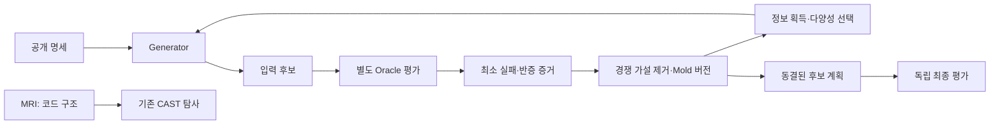

# Antemortem Structural Lab

신뢰할 수 있는 Python 함수를 검사하고, 실패한 입력을 저장하며, 그 실패를 설명하는 경쟁 가설로 다음 테스트를 선택하는 실험 도구입니다. 코드 구조를 읽는 **MRI**, 실행 결과를 관측하는 **CAST**, 반례를 찾는 **Claim-to-Witness**, 실패 조건을 학습하는 **Mold**를 제공합니다.

**한국어 사용자 안내** · [English](README.md) · [변경 이력](CHANGELOG.md) · [검증 기록](docs/RELEASE_VALIDATION.md)

`0.4.0a1`은 Hypothesis·AST·Z3를 통합한 실험적 사전 릴리스입니다. 기능 구현과 실제 프로젝트에서의 성능 우월성은 별개의 문제입니다.

## 어떤 문제를 다루나요?

정적 분석은 코드의 조건을 보여 주지만 실제 위반을 확인하려면 실행이 필요합니다. 무작위 테스트는 위반을 찾을 수 있지만 이전 실패에서 얻은 구조를 다음 입력에 사용하지 않을 수 있습니다. 이 도구는 두 정보를 연결하고, 발견한 반례와 가설의 출처를 남깁니다.

Mold는 실패 좌표 하나를 다른 프로그램에 그대로 적용하지 않습니다. 같은 증거를 설명하는 여러 관계식을 유지하고, 서로 다른 예측을 내는 입력을 선택합니다. 새 대상에서는 변수의 역할과 명시된 계약을 먼저 확인합니다. 계약이 맞더라도 **탐색에 사용할 수 있다는 뜻이며, 같은 결함이 존재한다는 증명은 아닙니다.**

## 구조와 지원 기능



| 기능 | 구현 범위 |
| --- | --- |
| MRI / CAST | 제한된 Python 조건문 분석, 분기 관측, 참조 함수와 결과 비교 |
| Claim-to-Witness | 한국어·영어의 고정 문장 6개를 관계식 3종에 연결, 반례 저장·재실행 |
| Mold | 실패 로그 정규화, 유한 관계식 가설 공간, 반례에 의한 후보 제거 |
| 다음 입력 선택 | 가설 간 불일치가 큰 입력과 주기적인 공간 다양성 탐사 |
| 제약·이력 | 증거, 반증, 경쟁 가설, 버전, 출처, 범위, 불확실성을 JSON으로 보존 |
| 적용 검사 | 변수 역할의 일대일 대응, 연산 의미·불변식·계약 일치 확인; 불충분하면 `UNKNOWN` |
| Solver | 기본 유한 영역 열거; 선택적으로 Z3 사용 |
| 평가 경계 | 생성기 별도 프로세스, 선택적 Docker 생성기, 동결 후 학습 차단 |
| 속성 기반 테스트 | 기존 Mold 후보를 Hypothesis로 검사, 평가기 전용 수치 반례 축소, 중복 평가 캐시 |
| 확장 구조 관계 | 공개 AST 산술·비교·Boolean 관계식, enum/Z3 일관성, 구조 증거 기반 후보 필터 |

새 Mold의 관계식은 `left`와 `right` 역할에 대한 합·차·절댓값 관계와 합의 나머지(2·3·5)입니다. 지원하는 정수 임계값과 `eq` / `le` / `ge` 비교로 가설 공간을 구성합니다. 자유로운 프로그램 의미를 자동으로 복원하지 않습니다.

## 빠른 시작

Python **3.11 이상**이 필요합니다. 기본 실행에는 유료 모델·API나 Z3가 필요하지 않습니다.

GitHub Release의 wheel 설치:

```bash
python -m pip install https://github.com/hibou04-ops/antemortem-structural-lab/releases/download/v0.4.0a1/antemortem_structural_lab-0.4.0a1-py3-none-any.whl
python -m tomolab mold-demo --budget 32 --seed 7 --backend subprocess --solver enumeration --output results/mold.json
```

`mold-demo`는 동봉된 검토 가능한 예제만 실행합니다. 결과의 `status`는 `COUNTEREXAMPLES_FOUND` 또는 `NOT_REFUTED_WITHIN_BUDGET`입니다. `failures`에는 최소 실패 증거, `snapshot`에는 경쟁 가설과 Mold 버전이 들어갑니다. 대상·Oracle 해시, 호출 수, 격리 수준도 기록합니다. 실패를 찾지 못했거나 가설이 하나로 줄었다는 사실만으로 함수의 정확성이 증명되지는 않습니다.

소스와 예제를 함께 받으려면:

```bash
git clone https://github.com/hibou04-ops/antemortem-structural-lab.git
cd antemortem-structural-lab
python -m pip install -e .
```

PowerShell에서도 명령을 한 줄씩 실행할 수 있습니다. `tomolab` 명령과 `python -m tomolab`은 같은 CLI를 사용합니다. 이 배포는 GitHub Release에 게시하며, PyPI 게시를 전제로 하지 않습니다.

## 사용 예제

### 기존 Claim-to-Witness

첫 명령은 대상 코드를 실행하지 않습니다. 뒤의 실행·재실행 명령은 신뢰하는 로컬 예제를 실행합니다.

```bash
python -m tomolab claim-compile --claim "두 정수 입력의 순서를 바꿔도 반환값은 같다"
python -m tomolab claim-run examples/claim_only/symmetry_bug.py --claim "두 정수 입력의 순서를 바꿔도 반환값은 같다" --mode cross --budget 12 --allow-local-execution --output results/symmetry.json
python -m tomolab claim-replay results/symmetry.json --allow-local-execution
python -m tomolab demo --mode cross --budget 12
```

대칭성 예제는 `(17, -3)`에서 15, `(-3, 17)`에서 14를 반환합니다. 정의한 관계식의 반례입니다. 원래 자연어 요구사항의 모든 의미가 검증된 것은 아닙니다. 반례가 없으면 `NOT_REFUTED_WITHIN_BUDGET`으로 남습니다. [Phase C0 상세 설명](PHASE_C_README_KO.md)을 참고하세요.

### 별도 Oracle로 Mold 학습

저장소의 예제 명세·대상·Oracle을 분리해 실행합니다.

```bash
python -m tomolab mold-run examples/mold/target.py --oracle-file examples/mold/oracle.py --spec examples/mold/spec.json --function implementation --oracle reference --allow-local-execution --budget 32 --seed 7 --output results/mold-run.json
```

Oracle은 생성기와 별도로 정답을 계산합니다. 생성기는 허용된 구조화 증거만 받아 가설을 갱신합니다. 성공 점수나 자연어 평가는 보상으로 사용하지 않습니다. 관측으로 제거된 가설과 남은 가설을 함께 확인해야 합니다.

### 동결 후 새 명세에 입력 계획

```bash
python -m tomolab mold-plan --snapshot results/mold-run.json --spec examples/mold/renamed-spec.json --budget 32 --output results/mold-plan.json
```

이 명령은 대상 함수를 실행하지 않습니다. 동결한 Mold와 공개 명세로 후보만 만듭니다. 변수 이름이 바뀌어도 역할과 계약이 대응하면 `APPLICABLE_FOR_PROBING`으로 탐색을 허용합니다. 근거가 맞지 않으면 `UNKNOWN`으로 남기고 전이 제약 없이 탐색합니다. 최종 평가 결과는 동결된 생성기로 돌려보내지 않습니다.

선택적 Z3 설치는 소스 디렉터리에서 `python -m pip install -e ".[solver]"`로 할 수 있습니다. 이후 `--solver z3`를 사용하세요. Z3가 없으면 해당 선택은 명시적으로 실패하며, Z3로 검사한 것처럼 표시하지 않습니다. 기본 Docker 이미지는 Z3를 포함하지 않습니다.

### Hypothesis 반례 생성·축소와 AST 제약 검사

```bash
python -m pip install -e ".[qa,solver]"
python -m tomolab pbt-demo --budget 32 --shrink-budget 128 --output results/pbt.json
python -m tomolab constraints-check --spec examples/mold/spec.json --expression "abs(x - y) <= 3 and x + y >= 2" --solver z3
python -m tomolab pbt-run examples/mold/target.py --oracle-file examples/mold/oracle.py --spec examples/mold/spec.json --allow-local-execution --output results/pbt-run.json
```

Hypothesis는 고정된 Mold 후보에서 검사·인덱스 축소를 수행하고, 동결 후 평가기에서
정수 반례를 추가로 축소합니다. `budget`은 후보 수이며 실제 호출수는 JSON의
`metrics.oracle_calls`입니다. 반복 검색은 캐시로 제거합니다. AST 관계식은 별도 API로
확장하며 기존 Mold 선택 문법은 유지합니다. 두 정수 입력과 유한 범위만 지원합니다.
Oracle 판정과 주관적 평가를 분리하고 최종 피드백은 차단합니다.
[E4 구현·검증·미구현 범위](docs/E4_IMPLEMENTATION.md)에 측정 정의와 한계를 기록했습니다.

## 기존 도구와의 관계

- **Hypothesis**는 폭넓은 속성 기반 테스트 도구이며 E4에서 직접 통합합니다. 이 패키지가 이를 대체하거나 성능에서 앞선다는 증거는 없습니다.
- **CrossHair**는 Python의 계약을 심볼릭 실행으로 검사합니다. 기존 비교에서 동일한 합성 결함 세 종류를 모두 찾았습니다. [비교 fixture](baselines/crosshair_claim_contracts.py)는 보존합니다.
- **Z3**는 선택적인 제약 검사 backend입니다. 기본은 작은 유한 영역을 완전히 열거하는 방식이며, 무제한 정수 공간의 증명을 주장하지 않습니다.
- **Jev**는 기존 분기 탐사에서 선택할 수 있는 후보 생성 연결입니다. Mold·Claim 경로는 유료 호출 없이 실행됩니다. [연결 이력](JEV_CONNECTION_CHANGELOG.md)과 [외부 기술 안내](docs/THIRD_PARTY.md)를 참고하세요.

## 연구 결과와 한계

E1은 `E1_EXECUTED_NO_IMPROVEMENT`, E2는 `E2_EXECUTED_NO_IMPROVEMENT`였습니다. E2의 후보 평가 26,880회에서 A/B/C/D의 주입 지점×시드 발견 합계는 76/75/72/76이었고, 시드를 합친 고유 주입 지점은 모두 16개였습니다. D와 기준선 A의 최종 후보·결과는 동일했고 새로운 portable constraint는 0개였습니다. 이 숫자는 독립적인 실제 결함 수가 아닙니다.

E3에서는 새로운 합성 문제로 후보 7,040회를 평가했습니다. 최종 평가에서 uniform/Mold의 주입 지점×시드 발견 수는 **30/30**, 고유 지점은 **6/6**이었습니다. 첫 발견 평균 호출은 21.025에서 17.5로 줄었지만(미발견은 65로 처리), 사전 기준이 요구한 발견 범위 증가는 없어 **`NO_IMPROVEMENT`**, 일반화는 **`GENERALIZATION_UNKNOWN`**입니다. 반복 실패 입력 증가를 새 결함 발견으로 세지 않습니다.

조건·집계는 [E3 평가 설명](docs/E3_EVALUATION.md), 구현·설치 검증은 [릴리스 검증 기록](docs/RELEASE_VALIDATION.md)과 [v0.3.0a1 릴리스 노트](docs/releases/v0.3.0a1.md)에 구분해 기록합니다. E1/E2 평가 자료는 이미 소비된 자료이며 새 블라인드 결과로 재사용하지 않았습니다. 일반적인 실제 프로젝트에 대한 우월성은 입증되지 않았습니다.

현재 Mold는 **순수하고 결정적인 정수 입력 2개·정수 출력 함수**와 최대 4,225개의 유한 입력 영역(각 축 최대 65개)을 대상으로 합니다. 임의의 상태 전이 프로그램, 부동소수점, 외부 부작용, 자유로운 자연어 의미 검증은 지원하지 않습니다. 가설 공간 밖의 실패 구조를 복원할 수 있다고 가정하지 않습니다.

## 안전 모델

`--allow-local-execution`은 실행 동의 표시이며 보안 샌드박스가 아닙니다. 대상과 Oracle은 평가기 호스트에서 현재 사용자 권한으로 실행되므로 직접 작성했거나 검토한 코드에만 사용하세요.

기본 `subprocess` backend는 별도 프로세스 통신을 사용하지만 파일 접근 권한은 공유하므로 **`LOGICAL_ISOLATION_ONLY`**입니다. Docker backend는 생성기에 공개 코드만 읽기 전용으로 제공하고 네트워크·쓰기·권한을 제한합니다. 이것이 대상 Python 코드를 적대적 코드용 샌드박스로 바꾸지는 않습니다. Docker 준비와 실제 접근 통제 검증 범위는 [보안 안내](SECURITY.md)를 확인하세요.

결과에는 입력과 로컬 경로가 포함될 수 있습니다. `results/`와 비공개 연구 자료를 공개 저장소나 릴리스에 올리지 마세요.

## 개발·기여·이력

```bash
python -m pip install pytest build twine
python -m pytest -q
python -m build
python -m twine check dist/*
```

[기여 안내](CONTRIBUTING.md) · [이슈](https://github.com/hibou04-ops/antemortem-structural-lab/issues) · [Actions](https://github.com/hibou04-ops/antemortem-structural-lab/actions)

보이지 않는 개미집에 거푸집을 떠 내부 통로를 드러내는 모습에서 MRI·CAST라는 비유를 가져왔습니다. 초기 실험은 별도 보관본에서 Git으로 가져왔고, 커밋 시각을 과거 연구 시각으로 꾸미지 않았습니다. 기존 태그와 가져오기 기록은 [공개 이력 안내](PUBLIC_IMPORT_NOTICE.md)에 보존합니다.

| 버전 | 주요 변화 |
| --- | --- |
| [v0.1.0](docs/releases/v0.1.0.md) | 참조 함수를 사용하는 MRI·CAST 분기 탐사 |
| [v0.1.1](docs/releases/v0.1.1.md) | 선택적 TypeSafe Jev 연결 |
| [v0.2.0](docs/releases/v0.2.0.md) | Claim-to-Witness 관계식 반례 탐사 |
| [v0.3.0a1](docs/releases/v0.3.0a1.md) | 경쟁 가설·능동 질의·적용 검사 기반 Mold 통합 |
| [v0.4.0a1](docs/releases/v0.4.0a1.md) | Hypothesis 생성·축소, AST/Z3 검사, typed 정보 경계 강화 |

자연어와 검증 조건 사이의 의미 보존을 다루는 C1은 [별도 연구 PR](https://github.com/hibou04-ops/antemortem-structural-lab/pull/1)입니다. 이 릴리스의 Mold 구현과 혼동하지 마세요. 이 저장소는 [antemortem-cli](https://github.com/hibou04-ops/antemortem-cli)와 별개의 실험 프로젝트입니다.

Apache License 2.0 — [LICENSE](LICENSE).
