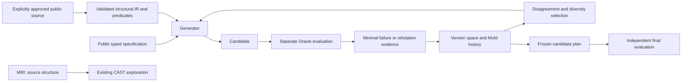

# Antemortem Structural Lab

An experimental Python tool that tests trusted functions, records failing inputs, and uses competing explanations of those failures to choose the next test. It combines **MRI** code inspection, **CAST** execution observations, **Claim-to-Witness** checks, and a **Mold** learning loop.

**[한국어 사용자 안내](README.ko.md)** · [Changelog](CHANGELOG.md) · [Validation record](docs/RELEASE_VALIDATION.md)

`0.7.0a1` adds experimental **Evidence-Gated Structural Knowledge**. Failure-membership hypotheses retain their supporting and contradicting evidence. Independently reviewed contrastive development evidence and compatible typed/semantic contracts qualify limited extra probes. Hypothesis performs ordinary generation and shrinking. See [knowledge contracts](docs/E7_KNOWLEDGE.md) and the [E7 evaluation record](docs/E7_EVALUATION_REPORT.md).

## PyPI 배포 채널 — 기존 E7 공개 파일

배포 이름은 `antemortem-structural-lab`, Python import와 CLI는 `tomolab`입니다. [PyPI 수동 발행 workflow](.github/workflows/publish-pypi.yml)가 성공한 뒤 [공개 버전](https://pypi.org/project/antemortem-structural-lab/0.7.0a1/)에서 파일을 확인하고 설치합니다. 아래는 그 공개 설치 검증에 사용하는 명령이며, workflow 추가만으로 게시 완료를 뜻하지 않습니다.

```bash
python -m pip install "antemortem-structural-lab==0.7.0a1"
python -m pip check
python -c "import tomolab; from importlib.metadata import version; print(version('antemortem-structural-lab'))"
tomolab --help
python -m tomolab --help
python -m tomolab demo --mode cross --budget 12
```

기본 설치는 MRI·CAST·Claim·E4 기능을 제공합니다. 아래 E7 탐색 예제에는 `qa`와 `solver` 선택 의존성을 설치합니다. 데모는 동봉된 공개 기능 fixture이며 연구 성능이나 새 결함 발견의 증거가 아닙니다.

이번 채널 추가의 업로드 대상은 [기존 `v0.7.0a1` GitHub Release](https://github.com/hibou04-ops/antemortem-structural-lab/releases/tag/v0.7.0a1)의 **동일 wheel·sdist**입니다. 현재 README의 채널 안내를 넣어 재빌드한 파일을 원본 대신 게시하지 않습니다. 원본 파일은 당시 README를 그대로 포함하고, 현재 저장소의 안내와 구분합니다. E7의 `INCONCLUSIVE` 판정과 연구 PR #1·#8의 조건은 유지합니다. [태그·파일 해시·발행 및 공개 재설치 절차](docs/PYPI_PUBLISHING.md)를 참조하세요.

## E7 evidence-gated discovery

Claims distinguish `HYPOTHESIS`, `SUPPORTED_WITHIN_SCOPE`, `CONTRADICTED`, `APPLICABILITY_UNKNOWN` and `QUALIFIED_FOR_PROBING`. Qualification requires both positive and negative observations from the same separately reviewed implementation/Oracle identity, plus typed roles, operation semantics and applicable state/IR contracts. Hashes bind identity and integrity; semantic independence remains a reviewed host attestation.

Without qualified claims, native Hypothesis runs without starting a worker, pool or solver. Qualified plans limit guidance to at most half the total plan budget and preserve the native search path; exhaustion of a finite domain can change the actual candidate proportions. They use a bounded guidance prefix, freeze, native search/shrinking and independent replay. Stateful Python APIs also reuse native RuleBasedStateMachine; the existing E6 CLI remains available. CI covers Python 3.11–3.13; package metadata allows 3.11+, with later Python versions outside this validation. Local QA uses Hypothesis6.170.11/Z35.3.2.0.

```bash
python -m pip install "antemortem-structural-lab[qa,solver]==0.7.0a1"
python -m tomolab knowledge-demo --budget 16 --guidance-budget 4 --pool-size 16 --shrink-budget 16 --output results/e7.json
python -m tomolab knowledge-demo --case clean --budget 12 --guidance-budget 4 --pool-size 8 --shrink-budget 0 --output results/e7-clean.json
```

The authored directed-width fixture tests an actual `lower > upper` structural probe and its refutation. Its IR describes an explicitly public reference model, not a hidden target implementation. Separately written forms of this curated failure are functional evidence, not real-project generalization evidence.

From a checkout or the wheel's bundled example directory:

```bash
python -m tomolab knowledge-inspect --spec examples/knowledge/target-spec.json
python -m tomolab knowledge-learn --spec examples/knowledge/source-spec.json --failure-log examples/knowledge/source-failures.json --provenance examples/knowledge/source-provenance.json --public-ir examples/knowledge/source-ir.json --observations examples/knowledge/observations.json --approve-development-evidence --store results/e7-journal.jsonl --record-id development-1 --output results/e7-mold.json
python -m tomolab knowledge-plan --archive results/e7-mold.json --spec examples/knowledge/target-spec.json --target-provenance examples/knowledge/target-provenance.json --public-ir examples/knowledge/target-ir.json --budget 8 --guidance-budget 4 --pool-size 16 --output results/e7-plan.json
python -m tomolab knowledge-run examples/knowledge/target.py --oracle-file examples/knowledge/target_oracle.py --archive results/e7-mold.json --spec examples/knowledge/target-spec.json --target-provenance examples/knowledge/target-provenance.json --public-ir examples/knowledge/target-ir.json --failure-signature directed-width --allow-local-execution --budget 16 --guidance-budget 4 --pool-size 16 --shrink-budget 16 --output results/e7-run.json
python -m tomolab knowledge-update --archive results/e7-mold.json --observations examples/knowledge/counterevidence.json --generation-id development-2 --approve-development-evidence --store results/e7-journal.jsonl --record-id development-2 --output results/e7-updated.json
python -m tomolab knowledge-inspect --archive results/e7-updated.json --spec examples/knowledge/target-spec.json --target-provenance examples/knowledge/target-provenance.json --public-ir examples/knowledge/target-ir.json --output results/e7-updated-gate.json
```

Learning consumes JSON evidence without executing its target. Approval flags identify trusted development evidence; they cannot authenticate arbitrary labels. External runs require separately reviewed `implementation(**inputs)` and `reference(**inputs)` files and explicit local execution consent. That consent does not sandbox those files.

The append-only store preserves each frozen parent, full evidence and contradiction history. Explicit new generations accept only new development receipts. Identical record IDs are idempotent; rollback, corrupt appends and cooperating-writer lock collisions fail closed. Source and independent development events are each bounded to 256 total, with at most 32 forks. Final observations remain forbidden.

```bash
docker build -f containers/e7-generator.Dockerfile -t tomolab-e7-generator:local containers
python -m tomolab knowledge-demo --backend docker --budget 16 --guidance-budget 4 --pool-size 16 --shrink-budget 16 --output results/e7-container.json
```

Default subprocess isolation remains `LOGICAL_ISOLATION_ONLY`; Docker limits the Generator only. Targets and Oracles are trusted host code. Full wall cost includes gating, generation, solver, IPC, Oracle and native search/shrink; overlapping phases are not additive. Engine snapshot replay is verified with matching Hypothesis/Z3 versions, not arbitrary library upgrades.

E1–E6 evidence and negative results are preserved. E6's 12 refuted representative candidates out of 13 are not an accuracy estimate for every Mold. E7 development v1 is `INVALID_ORACLE / INCONCLUSIVE` following an Oracle precision error. The exact-arithmetic correction passed independent review and the v2 contract is registered; actual execution results are reported separately. Rechecking previously observed development cases is not a new blind evaluation. Rejecting every prior and matching the baseline does not establish marginal discovery value.

The new once-only final comparison recorded 54 COMPLETE and 18 Stateful NOT_COMPARABLE rows. Required-method errors, timeouts, control false alerts and Generator feedback were zero. Native Hypothesis, E6 and E7 each found zero mismatches; primary qualified claims and guidance were also zero. Discovery advantage, useful knowledge transfer and external generalization remain **INCONCLUSIVE**. This compares at most64 frozen public-spec candidates without final feedback, not full adaptive Hypothesis PBT. Automatic semantic correspondence learning for arbitrary Python programs is unimplemented; transfer depends on reviewed role and semantic contracts.

## Preserved E6 implementation

The `v0.6.0a1` Stateful Structural Mold and typed EFSM support remain available. See [E6 integration](docs/E6_INTEGRATION.md) and its [frozen evaluation](docs/E6_EVALUATION_REPORT.md).

## E6 stateful discovery

The engine relates semantic actions, public before/after state, order, preconditions and the first failing transition. It retains competing membership hypotheses and removes refuted alternatives. Initial projections must match the public contract. Transfer distinguishes `APPLICABLE_FOR_PROBING`, `NOT_APPLICABLE`, `UNKNOWN` and `CONTRADICTED`; permission to probe is not proof of repeated defects.

Native `RuleBasedStateMachine`, `rule`, `precondition`, `invariant` and `Bundle` preserve ordinary generation. Cold initialization avoids a precomputed pool; checked failure or approved prior activates constraints once. Qualified disagreement and incremental integer Z3 `push/pop` witnesses affect actual query selection. A selected SAT witness avoids a redundant generated batch. Caches include specification, engine version and actual input; live state mutation is never skipped.

```bash
python -m pip install "antemortem-structural-lab[qa,solver] @ https://github.com/hibou04-ops/antemortem-structural-lab/releases/download/v0.6.0a1/antemortem_structural_lab-0.6.0a1-py3-none-any.whl"
python -m tomolab stateful-demo --budget 128 --pool-size 12 --shrink-budget 64 --output results/e6.json
python -m tomolab stateful-demo --case clean --budget 24 --pool-size 8 --shrink-budget 0 --output results/e6-clean.json
```

The bundled two-action stack is a regression for E5's known last-element omission, not a new independent research defect. Its separate model checks size, not arbitrary stack contents/order. In a source checkout:

```bash
python -m tomolab stateful-inspect --contract examples/temporal/stack-contract.json --output results/e6-contract.json
python -m tomolab stateful-run examples/temporal/stack_target.py --oracle-file examples/temporal/stack_oracle.py --contract examples/temporal/stack-contract.json --allow-local-execution --budget 128 --pool-size 12 --shrink-budget 64 --output results/e6.json
python -m tomolab stateful-plan --snapshot results/e6.json --contract examples/temporal/renamed-contract.json --budget 8 --pool-size 12 --output results/e6-plan.json
```

Subject and independent model files each export `make_subject()`; objects implement `step(action, argument)` and `snapshot()`. Projections contain exactly the declared numeric state roles. Controls are checked before target import, and `stateful-inspect` executes no target.

The EFSM supports up to four finite numeric projections and sixteen actions, bounded arithmetic/conditional simultaneous assignments, pre/postconditions, dependencies and invariants. Native stateful execution supports at most 129 integer argument values, sixteen steps and `min_size=0`. Float action arguments, arbitrary live-object semantics and nonterminating callbacks are unsupported. E5's broader typed APIs remain available.

Only public contracts, approved IR and minimal development labels cross the Generator boundary. Raw expected/actual states, hidden final source and subjective scores are excluded. Frozen registration and feedback are blocked before transport. Native shrinking and independent replay run in the trusted evaluator after freeze; resource exhaustion does not establish completed shrinking or minimality.

```bash
docker build -f containers/e6-generator.Dockerfile -t tomolab-e6-generator:local containers
python -m tomolab stateful-demo --backend docker --budget 128 --pool-size 12 --shrink-budget 64 --output results/e6-container.json
```

Default subprocess isolation is `LOGICAL_ISOLATION_ONLY`. Docker limits only the Generator and is checked separately in CI; targets and models remain trusted host callbacks. Metrics distinguish actual transition calls from whole-trace evaluations, native/pool/Version Space/solver/Oracle/shrink work, dispatch and transport residual. Some phases overlap and RSS samples are not OS peaks. E5 historical whole-function Oracle counts are not interchangeable with E6 transition units.

E1–E5 evidence and negative results are preserved. E6's once-only frozen final produced 84 records: 78 COMPLETE and six static Native Stateful NOT_COMPARABLE, with no errors, timeouts, source drift or Generator feedback. All methods found 15/15 stateful runs, but the paired E6/Hypothesis median wall ratio was 2.321. Both development and final conclude **NO_IMPROVEMENT**. Independent development traces refuted 12 of 13 candidate hypotheses and one source remains OUT_OF_GRAMMAR, so grammar resolution is PARTIAL. External real-project generalization remains NOT_EXECUTED. See the [evaluation record](docs/E6_EVALUATION_REPORT.md).

## Preserved MRI, CAST, Claim and E5 features


## The problem

Static analysis exposes conditions; execution supplies witnesses. Random tests may find violations without using the structure suggested by earlier failures. This lab connects those observations while preserving their provenance and limits.

The Mold engine does not assume that a failing coordinate transfers to another program. It retains multiple relations consistent with the evidence, asks queries where they disagree, and checks variable roles and declared contracts before using a learned relation on another target. A matching contract permits probing; it does **not** prove that the new target contains the same bug.

## Architecture and supported features



| Feature | Current implementation |
| --- | --- |
| MRI / CAST | Restricted Python condition analysis, branch observations, executable reference comparison |
| Claim-to-Witness | Six fixed Korean/English sentences, three relations, saved counterexamples and replay |
| E4 Mold | Preserved two-integer relation grammar, evidence and counterexample-guided hypothesis elimination |
| E5 Discovery | Typed inputs, public AST predicates and competing failure-membership hypotheses in one learning loop |
| Query selection | Disagreement and diversity selection; E5 adds fresh native Strategy candidates and supported Z3 witnesses to actual selection |
| Provenance | Evidence, refutations, competing hypotheses, versions, scope and uncertainty in JSON |
| Applicability | Bijective variable-role mapping and matching operation, invariant and semantic contract; otherwise `UNKNOWN` |
| Constraint checking | E4 bounded enumeration; E5 concrete predicate checks and optional Z3 over an explicitly supported subset |
| Evaluation boundary | Separate generator process, optional Docker generator, frozen learning state |

The preserved E4 relation grammar covers sums, differences, absolute-value relations and sum residues modulo 2, 3 or 5 over `left` and `right` roles. E5 extends the grammar with typed measurements and supported input-dependent AST guards. Neither grammar infers arbitrary program semantics.

## Quick start

Requires **Python 3.11+**. E5 search uses the `qa` extra; select the `solver` extra for Z3. MRI, CAST, Claim and E4 Mold remain available without a paid model or API.

수동 PyPI 발행이 성공한 뒤 정확한 alpha 버전으로 설치합니다:

```bash
python -m pip install "antemortem-structural-lab[qa,solver]==0.7.0a1"
python -m tomolab discovery-demo --case sequence --solver z3 --budget 32 --output results/discovery.json
python -m tomolab discovery-demo --case state --budget 32 --output results/state.json
python -m tomolab mold-demo --budget 32 --seed 7 --backend subprocess --solver enumeration --output results/mold.json
```

These demos run only bundled reviewable fixtures. Results include failures, a snapshot of competing hypotheses, provenance, actual call counts and isolation level. Finding no failure, or retaining one hypothesis, does not establish target correctness.

To obtain the source and examples:

```bash
git clone https://github.com/hibou04-ops/antemortem-structural-lab.git
cd antemortem-structural-lab
python -m pip install -e ".[qa,solver]"
```

Each command also works as a single line in PowerShell. `tomolab` and `python -m tomolab` use the same CLI. 과거 GitHub 전용 발행 기록은 보존합니다. 추가 PyPI 채널의 실제 발행·공개 다운로드 검사는 [배포 안내](docs/PYPI_PUBLISHING.md)와 해당 workflow 결과에서 별도로 확인합니다.

## Examples

### E5: inspect, learn and freeze structural probes

Run these commands from the source checkout. The sequence example is a reviewed public development fixture, so its source may be explicitly approved for structural analysis. For other tasks, supply an approved public reference skeleton; private target and Oracle source must not be used as public IR.

```bash
python -m tomolab discovery-inspect examples/discovery/sequence_target.py --spec examples/discovery/sequence-spec.json --output results/sequence-public.json
python -m tomolab discovery-run examples/discovery/sequence_target.py --oracle-file examples/discovery/sequence_oracle.py --spec examples/discovery/sequence-spec.json --public-source examples/discovery/sequence_target.py --allow-local-execution --solver z3 --budget 32 --shrink-budget 64 --time-budget 10 --output results/sequence-run.json
python -m tomolab discovery-plan --snapshot results/sequence-run.json --spec examples/discovery/sequence-renamed-spec.json --public-source examples/discovery/sequence_renamed.py --solver z3 --budget 32 --output results/sequence-plan.json
```

`discovery-inspect` parses without importing or executing the source and saves the bound `spec` and `public_ir` together. `--public-ir` accepts the inner IR object, not that combined inspection document. `--public-source` is an explicit approval to expose its validated structural representation to the generator. A declared `UNKNOWN` graph signature is bound to this approved IR; conflicting signatures are rejected.

During learning, supported public guards become real hypothesis terms. Failure and refutation evidence eliminate inconsistent alternatives. Active selection combines disagreement and input diversity with fresh native Hypothesis Strategy draws; supported Z3 solutions are concretely checked and enter the candidate pool. Hypothesis shrinking runs separately in the evaluator after freezing. A solver witness establishes consistency of encoded constraints, not the existence of a target bug.

The typed schema supports 1–6 named inputs: bounded integers, finite floats, strings with declared alphabets or choices, lists, fixed tuples and dictionaries with declared finite string keys. Strings have at most 64 characters, lists/dictionaries at most 16 entries, tuples at most 8 slots, and nested types have a bounded depth. State examples encode finite operation traces as typed values passed to trusted functions. This does not establish support for arbitrary live state, unbounded loops or external effects. The integrated reference evaluator currently accepts exactly one declared invariant.

Z3 supports a narrower subset: bounded integers, selected ASCII string lengths/content and integer sequence operations. Floats, general nested/dictionary predicates and unsupported arithmetic return `UNKNOWN`; they remain available to native generation and concrete evaluation. AST extraction also records unsupported guards rather than inventing constraints for them. Static IR support is a syntax result, not a semantic equivalence proof.

`discovery-plan` runs a fresh generator with a frozen source snapshot, public target contract and approved target IR. Role mappings, type/domain inclusion, operation, declared preconditions/invariants, normalized graph and supported guard predicates constrain transfer. Approved development counterevidence can remove contradicted priors via `--target-evidence`. Applicability permits probing; failure recurrence remains `UNKNOWN`. The literal-free graph does not prove all return-value semantics. Final labels must never be supplied as development counterevidence or sent back to the frozen generator.

The generator receives public typed contracts, validated IR and minimal structured development evidence. Target/Oracle callables, source, expected outputs, evaluator shrinking and CrossHair execution stay outside its supplied package and protocol. The default subprocess boundary remains `LOGICAL_ISOLATION_ONLY`; see [Security](SECURITY.md) and [E5 implementation and evaluation](docs/E5_INTEGRATION.md).

### Existing Claim-to-Witness path

Compilation does not execute the target. The following run and replay commands execute trusted local fixtures.

```bash
python -m tomolab claim-compile --claim "Swapping the two integer inputs does not change the result"
python -m tomolab claim-run examples/claim_only/symmetry_bug.py --claim "Swapping the two integer inputs does not change the result" --mode cross --budget 12 --allow-local-execution --output results/symmetry.json
python -m tomolab claim-replay results/symmetry.json --allow-local-execution
python -m tomolab demo --mode cross --budget 12
```

The symmetry fixture returns 15 at `(17, -3)` and 14 at `(-3, 17)`. This is a counterexample to the encoded relation, not a verification of every interpretation of the natural-language claim. Searches without a witness remain `NOT_REFUTED_WITHIN_BUDGET`. See [Phase C0 details](PHASE_C_README_KO.md).

### Learn with a separate Oracle

```bash
python -m tomolab mold-run examples/mold/target.py --oracle-file examples/mold/oracle.py --spec examples/mold/spec.json --function implementation --oracle reference --allow-local-execution --budget 32 --seed 7 --output results/mold-run.json
```

The Oracle computes expected outputs independently of the generator. The generator receives structured evidence only; it does not use success scores or natural-language rewards. Inspect both surviving hypotheses and eliminated hypotheses rather than reading one relation as established truth.

### Plan after freezing

```bash
python -m tomolab mold-plan --snapshot results/mold-run.json --spec examples/mold/renamed-spec.json --budget 32 --output results/mold-plan.json
```

This command does not execute target code. It produces candidates from a frozen Mold and public specification. Renamed variables can receive `APPLICABLE_FOR_PROBING` when roles and contracts match. Inapplicable transfer is recorded as `UNKNOWN`, with exploration continuing without transferred constraints. Final evaluation results must not feed back into the frozen generator.

For optional Z3 support, run `python -m pip install -e ".[solver]"` from the source directory and select `--solver z3`. If Z3 is absent, that choice fails explicitly rather than being reported as a solver-backed check. The default Docker image does not contain Z3.

### E4: Hypothesis generation, shrinking and AST constraints

```bash
python -m pip install -e ".[qa,solver]"
python -m tomolab pbt-demo --budget 32 --shrink-budget 128 --output results/pbt.json
python -m tomolab constraints-check --spec examples/mold/spec.json --expression "abs(x - y) <= 3 and x + y >= 2" --solver z3
python -m tomolab pbt-run examples/mold/target.py --oracle-file examples/mold/oracle.py --spec examples/mold/spec.json --allow-local-execution --output results/pbt-run.json
```

E4 searches fixed Mold candidate batches with Hypothesis, then performs numeric shrinking
inside the evaluator after freezing. Candidate count and actual Oracle calls are
reported separately; repeated search attempts use a pure-function cache. Public
AST expressions support arithmetic, comparisons and Boolean composition, with
bounded enumeration/Z3 consistency and structured-evidence filtering APIs. AST
predicates do not replace the existing E4 Mold selection grammar. E4 supports only
two bounded integer inputs. See [E4 implementation and limits](docs/E4_IMPLEMENTATION.md).
The new public final fixtures are separate from development, nonblind, and do not
establish external generalization or superiority. Old E1/E2/E3 evidence is preserved.

## Relationship to established tools

- **Hypothesis** offers general property-based testing. E4 integrates batch search and shrinking; E5 also uses native typed strategies for fresh structural candidate generation. This project does not replace it or demonstrate superiority over it.
- **CrossHair** checks Python contracts through symbolic execution. In the earlier comparison, it found all three supplied synthetic violations. The [comparison fixture](baselines/crosshair_claim_contracts.py) remains available.
- **Z3** is an optional constraint-checking backend. E4 can exhaustively check its small finite integer domain; E5 uses a documented symbolic subset and concretely validates witnesses. Neither establishes correctness over an undeclared, unbounded domain.
- **Jev** remains an optional candidate-selection adapter for the older branch experiment. Mold and Claim commands require no paid calls. See the [connection history](JEV_CONNECTION_CHANGELOG.md) and [third-party notes](docs/THIRD_PARTY.md).

## Research results and limits

E1 concluded `E1_EXECUTED_NO_IMPROVEMENT`. E2 concluded `E2_EXECUTED_NO_IMPROVEMENT`. E2 used 26,880 candidate Oracle calls; A/B/C/D found 76/75/72/76 task-site-by-seed instances, with 16 distinct injected task sites each across seeds. D and baseline A produced identical final candidates and records. New portable constraints: zero. These are not counts of independent real-world defects.

E3 evaluated 7,040 candidates on new synthetic problems. Final uniform/Mold task-site-by-seed discoveries were **30/30**, with **6/6** distinct sites. Mean first-discovery calls decreased from 21.025 to 17.5 (non-discoveries censored at 65), but the preregistered discovery-breadth criterion was unmet: **`NO_IMPROVEMENT`**, with **`GENERALIZATION_UNKNOWN`**. Repeated failing inputs are not new defects.

See the [E3 protocol and aggregates](docs/E3_EVALUATION.md), [release validation](docs/RELEASE_VALIDATION.md) and [v0.3.0a1 notes](docs/releases/v0.3.0a1.md) for separate research, implementation and packaging evidence. E1/E2 data are consumed and were not reused as fresh blind evidence. General superiority on real projects remains unproven.

The E5 public development comparison executed **70 runs** over **five authored fault families and two unchanged project controls**. E5, native Hypothesis and source-aware CrossHair each found all five fault families. E4 supports only the two-integer stratum; 15 E4 runs were `NOT_COMPARABLE`, not failed detections.

| Public development metric | E5 | Native Hypothesis |
| --- | --- | --- |
| Actual Oracle calls | 1,524 | 919 |
| Total observed wall time | 42.607 s | 18.376 s |
| Distinct authored fault families found | 5/5 | 5/5 |

The paired median E5/Hypothesis total-wall ratio was **2.660**, and the paired median first-failure Oracle-call ratio was **1.0**. E5 did not meet the preregistered efficiency criterion: **`NO_IMPROVEMENT`**. CrossHair is reported in a separate source-aware tier because its internal symbolic Oracle-call count is unavailable.

Independent development audits contradicted **2 of 5 checked candidate hypotheses** using **440 additional validation inputs**. The **28/28** declared correspondence checks concern static contract gating, not target-bug recurrence or semantic equivalence.

The once-only frozen final evaluation completed **63 runs**: 48 `COMPLETE` and 15 E4 `NOT_COMPARABLE`. Its verdict was also **`NO_IMPROVEMENT`**. E5 used **1,344 Oracle calls and 30.815 s**, compared with **1,312 calls and 19.876 s** for the native Hypothesis Strategy plan. Both found all five authored fault families; the paired median E5/Hypothesis wall ratio was **1.540** and first-failure call ratio **1.0**. Final results supplied no feedback to the generator. See the [evaluation report](docs/E5_EVALUATION_REPORT.md), [public aggregate](docs/E5_RESULTS.json) and [E5 integration record](docs/E5_INTEGRATION.md) for the frozen protocol and limits. Existing consumed E1/E2/E3 holdouts are not fresh blind evidence. External real-project generalization remains `NOT_EXECUTED`.

The preserved E4 Mold supports **pure, deterministic functions with two integer inputs and one integer output**, within at most 4,225 inputs and 65 values per axis. E5 broadens declared input types and bounded trace testing, but arbitrary stateful programs, external side effects and general natural-language semantic fidelity remain unsupported. Do not assume that a finite grammar can recover failure structures outside that grammar.

## Safety model

`--allow-local-execution` records consent, not sandboxing. Targets and Oracles run in the evaluator host with the current user's privileges. Only use code you authored or independently reviewed and trust.

The default `subprocess` generator shares filesystem permissions and is labelled **`LOGICAL_ISOLATION_ONLY`**. The Docker generator receives only public code on a read-only mount, with network, write and privilege restrictions. It does not sandbox the target function against hostile behavior. See [Security](SECURITY.md) for setup and verified isolation scope.

Evidence may contain input values and local paths. Keep `results/` and private research materials out of public commits and release assets.

## Development, contribution and history

```bash
python -m pip install pytest build twine
python -m pytest -q
python -m build
python -m twine check dist/*
```

[Contributing](CONTRIBUTING.md) · [Issues](https://github.com/hibou04-ops/antemortem-structural-lab/issues) · [Actions](https://github.com/hibou04-ops/antemortem-structural-lab/actions)

The MRI/CAST names began with the image of revealing an ant nest through a cast. Earlier experiments were imported from archived snapshots; commit timestamps were not backdated to suggest an earlier Git history. Historical tags and import details remain in the [public import notice](PUBLIC_IMPORT_NOTICE.md).

| Version | Change |
| --- | --- |
| [v0.1.0](docs/releases/v0.1.0.md) | MRI/CAST branch exploration with a reference function |
| [v0.1.1](docs/releases/v0.1.1.md) | Optional TypeSafe Jev adapter |
| [v0.2.0](docs/releases/v0.2.0.md) | Claim-to-Witness relation checks |
| [v0.3.0a1](docs/releases/v0.3.0a1.md) | Integrated version-space, active-query and applicability-aware Mold |
| [v0.4.0a1](docs/releases/v0.4.0a1.md) | Hypothesis generation/shrinking, AST/Z3 checks and stricter typed boundaries |
| [v0.5.0a1](docs/releases/v0.5.0a1.md) | Unified typed structural discovery, native candidate generation, active Z3 witnesses and contradiction-aware frozen transfer |

C1, concerning semantic fidelity between natural-language claims and obligations, is a [separate research PR](https://github.com/hibou04-ops/antemortem-structural-lab/pull/1). It is distinct from this Mold release. This repository is also separate from [antemortem-cli](https://github.com/hibou04-ops/antemortem-cli).

Apache License 2.0 — [LICENSE](LICENSE).
