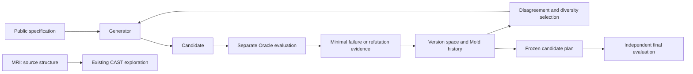

# Antemortem Structural Lab

An experimental Python tool that tests trusted functions, records failing inputs, and uses competing explanations of those failures to choose the next test. It combines **MRI** code inspection, **CAST** execution observations, **Claim-to-Witness** checks, and a **Mold** learning loop.

**[한국어 사용자 안내](README.ko.md)** · [Changelog](CHANGELOG.md) · [Validation record](docs/RELEASE_VALIDATION.md)

`0.3.0a1` is an experimental prerelease. Implemented functionality and demonstrated superiority on real projects are separate claims.

## The problem

Static analysis exposes conditions; execution supplies witnesses. Random tests may find violations without using the structure suggested by earlier failures. This lab connects those observations while preserving their provenance and limits.

The Mold engine does not assume that a failing coordinate transfers to another program. It retains multiple relations consistent with the evidence, asks queries where they disagree, and checks variable roles and declared contracts before using a learned relation on another target. A matching contract permits probing; it does **not** prove that the new target contains the same bug.

## Architecture and supported features



| Feature | Current implementation |
| --- | --- |
| MRI / CAST | Restricted Python condition analysis, branch observations, executable reference comparison |
| Claim-to-Witness | Six fixed Korean/English sentences, three relations, saved counterexamples and replay |
| Mold | Normalized evidence, finite relation grammar, counterexample-guided hypothesis elimination |
| Query selection | Disagreement queries with periodic spatial-diversity exploration |
| Provenance | Evidence, refutations, competing hypotheses, versions, scope and uncertainty in JSON |
| Applicability | Bijective variable-role mapping and matching operation, invariant and semantic contract; otherwise `UNKNOWN` |
| Constraint checking | Bounded enumeration by default; optional Z3 backend |
| Evaluation boundary | Separate generator process, optional Docker generator, frozen learning state |

The current relation grammar covers sums, differences, absolute-value relations and sum residues modulo 2, 3 or 5 over `left` and `right` roles. It uses a fixed finite threshold library and `eq` / `le` / `ge` comparisons. It does not infer arbitrary program semantics.

## Quick start

Requires **Python 3.11+**. The default runtime needs no paid model, API or Z3 installation.

Install the GitHub Release wheel:

```bash
python -m pip install https://github.com/hibou04-ops/antemortem-structural-lab/releases/download/v0.3.0a1/antemortem_structural_lab-0.3.0a1-py3-none-any.whl
python -m tomolab mold-demo --budget 32 --seed 7 --backend subprocess --solver enumeration --output results/mold.json
```

The demo runs only the bundled reviewable fixture. Its `status` is `COUNTEREXAMPLES_FOUND` or `NOT_REFUTED_WITHIN_BUDGET`. The JSON includes minimal `failures`, a `snapshot` of competing hypotheses and Mold versions, source hashes, call counts and isolation level. Finding no failure, or retaining one hypothesis, does not establish target correctness.

To obtain the source and examples:

```bash
git clone https://github.com/hibou04-ops/antemortem-structural-lab.git
cd antemortem-structural-lab
python -m pip install -e .
```

Each command also works as a single line in PowerShell. `tomolab` and `python -m tomolab` use the same CLI. This release is distributed on GitHub; it does not imply a PyPI publication.

## Examples

### Existing Claim-to-Witness path

Compilation does not execute the target. The following run and replay commands execute trusted local fixtures.

```bash
python -m tomolab claim-compile --claim "Swapping the two integer inputs does not change the result"
python -m tomolab claim-run examples/claim_only/symmetry_bug.py --claim "Swapping the two integer inputs does not change the result" --mode cross --budget 12 --allow-local-execution --output results/symmetry.json
python -m tomolab claim-replay results/symmetry.json --allow-local-execution
python -m tomolab demo --mode cross --budget 12
```

The symmetry fixture returns 15 at `(17, -3)` and 14 at `(-3, 17)`. This is a counterexample to the encoded relation, not a verification of every interpretation of the natural-language claim. Searches without a witness remain `NOT_REFUTED_WITHIN_BUDGET`. See [Phase C0 details](PHASE_C_README_KO.md).

### Learn with a separate Oracle

```bash
python -m tomolab mold-run examples/mold/target.py --oracle-file examples/mold/oracle.py --spec examples/mold/spec.json --function implementation --oracle reference --allow-local-execution --budget 32 --seed 7 --output results/mold-run.json
```

The Oracle computes expected outputs independently of the generator. The generator receives structured evidence only; it does not use success scores or natural-language rewards. Inspect both surviving hypotheses and eliminated hypotheses rather than reading one relation as established truth.

### Plan after freezing

```bash
python -m tomolab mold-plan --snapshot results/mold-run.json --spec examples/mold/renamed-spec.json --budget 32 --output results/mold-plan.json
```

This command does not execute target code. It produces candidates from a frozen Mold and public specification. Renamed variables can receive `APPLICABLE_FOR_PROBING` when roles and contracts match. Inapplicable transfer is recorded as `UNKNOWN`, with exploration continuing without transferred constraints. Final evaluation results must not feed back into the frozen generator.

For optional Z3 support, run `python -m pip install -e ".[solver]"` from the source directory and select `--solver z3`. If Z3 is absent, that choice fails explicitly rather than being reported as a solver-backed check. The default Docker image does not contain Z3.

## Relationship to established tools

- **Hypothesis** offers general property-based testing. This project does not replace it or demonstrate superiority over it.
- **CrossHair** checks Python contracts through symbolic execution. In the earlier comparison, it found all three supplied synthetic violations. The [comparison fixture](baselines/crosshair_claim_contracts.py) remains available.
- **Z3** is an optional constraint-checking backend. The default exhaustively checks a small finite domain; neither option establishes correctness over an undeclared, unbounded domain.
- **Jev** remains an optional candidate-selection adapter for the older branch experiment. Mold and Claim commands require no paid calls. See the [connection history](JEV_CONNECTION_CHANGELOG.md) and [third-party notes](docs/THIRD_PARTY.md).

## Research results and limits

E1 concluded `E1_EXECUTED_NO_IMPROVEMENT`. E2 concluded `E2_EXECUTED_NO_IMPROVEMENT`. E2 used 26,880 candidate Oracle calls; A/B/C/D found 76/75/72/76 task-site-by-seed instances, with 16 distinct injected task sites each across seeds. D and baseline A produced identical final candidates and records. New portable constraints: zero. These are not counts of independent real-world defects.

E3 evaluated 7,040 candidates on new synthetic problems. Final uniform/Mold task-site-by-seed discoveries were **30/30**, with **6/6** distinct sites. Mean first-discovery calls decreased from 21.025 to 17.5 (non-discoveries censored at 65), but the preregistered discovery-breadth criterion was unmet: **`NO_IMPROVEMENT`**, with **`GENERALIZATION_UNKNOWN`**. Repeated failing inputs are not new defects.

See the [E3 protocol and aggregates](docs/E3_EVALUATION.md), [release validation](docs/RELEASE_VALIDATION.md) and [v0.3.0a1 notes](docs/releases/v0.3.0a1.md) for separate research, implementation and packaging evidence. E1/E2 data are consumed and were not reused as fresh blind evidence. General superiority on real projects remains unproven.

Mold currently supports **pure, deterministic functions with two integer inputs and one integer output**, within at most 4,225 inputs and 65 values per axis. Arbitrary stateful programs, floating-point behavior, external side effects and general natural-language semantic fidelity are unsupported. Do not assume that a finite grammar can recover failure structures outside that grammar.

## Safety model

`--allow-local-execution` records consent, not sandboxing. Targets and Oracles run in the evaluator host with the current user's privileges. Only use code you authored or independently reviewed and trust.

The default `subprocess` generator shares filesystem permissions and is labelled **`LOGICAL_ISOLATION_ONLY`**. The Docker generator receives only public code on a read-only mount, with network, write and privilege restrictions. It does not sandbox the target function against hostile behavior. See [Security](SECURITY.md) for setup and verified isolation scope.

Evidence may contain input values and local paths. Keep `results/` and private research materials out of public commits and release assets.

## Development, contribution and history

```bash
python -m pip install pytest build twine
python -m pytest -q
python -m build
python -m twine check dist/*
```

[Contributing](CONTRIBUTING.md) · [Issues](https://github.com/hibou04-ops/antemortem-structural-lab/issues) · [Actions](https://github.com/hibou04-ops/antemortem-structural-lab/actions)

The MRI/CAST names began with the image of revealing an ant nest through a cast. Earlier experiments were imported from archived snapshots; commit timestamps were not backdated to suggest an earlier Git history. Historical tags and import details remain in the [public import notice](PUBLIC_IMPORT_NOTICE.md).

| Version | Change |
| --- | --- |
| [v0.1.0](docs/releases/v0.1.0.md) | MRI/CAST branch exploration with a reference function |
| [v0.1.1](docs/releases/v0.1.1.md) | Optional TypeSafe Jev adapter |
| [v0.2.0](docs/releases/v0.2.0.md) | Claim-to-Witness relation checks |
| [v0.3.0a1](docs/releases/v0.3.0a1.md) | Integrated version-space, active-query and applicability-aware Mold |

C1, concerning semantic fidelity between natural-language claims and obligations, is a [separate research PR](https://github.com/hibou04-ops/antemortem-structural-lab/pull/1). It is distinct from this Mold release. This repository is also separate from [antemortem-cli](https://github.com/hibou04-ops/antemortem-cli).

Apache License 2.0 — [LICENSE](LICENSE).
